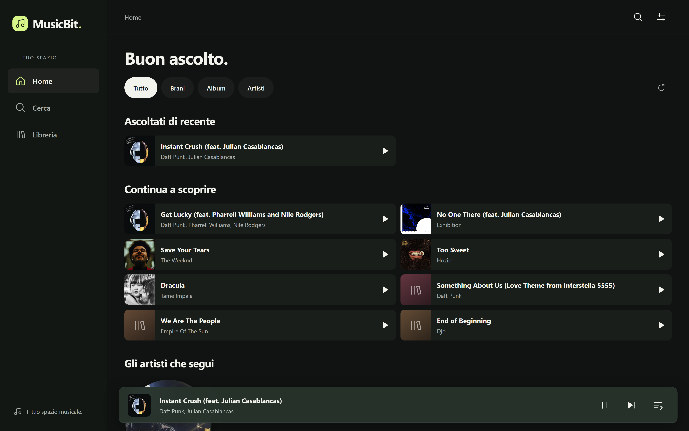
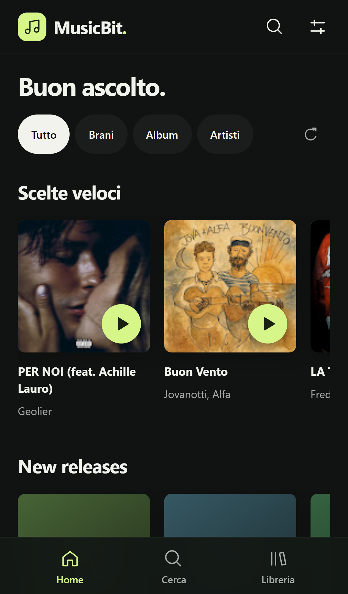
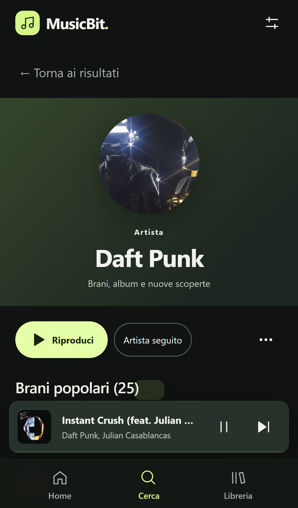
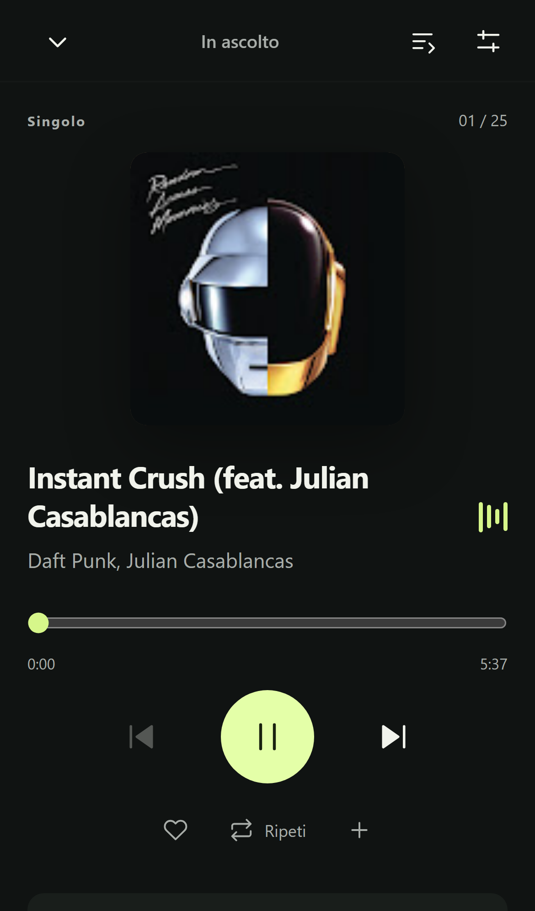

# MusicBit

**Your music. Your space.**

A self-hosted music player built for everyday listening, from your desktop to your phone. Discover music, build playlists and keep listening as you move through the app.

[](https://github.com/Gabriele30/musicbit/actions/workflows/ci.yml)
[](LICENSE)




[Get started](#get-started) · [Features](#features) · [Roadmap](docs/roadmap.md) · [Contributing](CONTRIBUTING.md)

## Features

- **Discover music** — a home feed, recent listening, followed artists and saved albums.
- **Search across the catalog** — songs, artists and albums together, category filters and removable recent searches.
- **Explore artists and albums** — popular tracks, discography, related artists and album playback.
- **Make it yours** — favorites, playlists, shuffle, drag-to-reorder with keyboard controls, and undo for removed tracks.
- **Keep your library across devices** — accounts, editable profiles, server-backed libraries, explicit conflict recovery and JSON backup/import.
- **Personal discovery** — suggestions informed by favorites and listening, with variety controls and dismissible recommendations.
- **Personal mixes and Taste Profile** — automatic playlists and visible artist affinity that you can correct.
- **Wrapped all year** — actual listening minutes, top tracks/artists and monthly statistics.
- **AI playlists** — describe a moment, preview catalog-verified proposals and save a playlist; requires a server-side OpenAI API key.
- **Resume on another device** — explicitly continue the saved account queue and position with one tap.
- **Keep the music going** — editable queue, repeat, staged autoplay recommendations and session restoration.
- **Listen on your phone** — an installable PWA, full-screen player, persistent mini-player and Media Session controls where supported.
- **Host it yourself** — React, TypeScript and Fastify, with Docker Compose included.

<table>
  <tr>
    <td></td>
    <td></td>
    <td></td>
  </tr>
  <tr><td>Discover</td><td>Explore</td><td>Listen</td></tr>
</table>

Screenshots show the running application. The interface is currently in Italian; documentation and contribution guides are in English.

## Get started

Requires **Node.js 24.x** and **pnpm 11.25.0**.

```sh
git clone https://github.com/Gabriele30/musicbit.git
cd musicbit
npm install --global pnpm@11.25.0
pnpm install --frozen-lockfile
```

Copy `.env.example` to `.env` once, then start the app:

```sh
# macOS / Linux
cp .env.example .env
pnpm dev
```

On Windows PowerShell, use `Copy-Item .env.example .env` instead of `cp`.

Open **[localhost:4175](http://localhost:4175)**. The API runs at `127.0.0.1:3001`; Vite proxies API requests to it. If you change `API_PORT`, update `API_PROXY_TARGET` too.

To try the production PWA locally:

```sh
pnpm build
pnpm start
```

Open **[localhost:4173](http://localhost:4173)**. The service worker is enabled in the production build; development uses Vite without it. See the [setup guide](docs/setup.md) for configuration and HTTPS on a phone.

### Docker

```sh
docker compose up --build -d
```

Open **[localhost:8080](http://localhost:8080)**. The default configuration binds the web service to loopback. Stop it with `docker compose down`.

For access from another device, use a trusted HTTPS connection. The HTTPS overlay requires an account for catalog/audio and closes registration; provision accounts first. See [accounts](docs/accounts.md) and [hosting and HTTPS](docs/setup.md#hosting-and-https).

## Project status

MusicBit is in active development. Catalog and playback use an **unofficial YouTube Music integration** and can be affected by upstream changes or availability. MusicBit is independent of YouTube, Google and Spotify.

Accounts synchronize libraries and save a separate listening session for explicit resumption on another device; guest libraries remain local. Export/import provides library recovery, and concurrent edits require an explicit choice between versions. The [persistent server audio cache](docs/server-audio-cache.md) prepares the next ten songs and holds up to 5 GB per account, reducing repeat playback and queue transition latency. There are currently **no offline audio downloads, lyrics, crossfade or remote speaker control**. The PWA caches the app shell; cached server audio still requires a connection. Playback stays paused after a reload until you press Play. See [listening features and AI setup](docs/listening-features.md) for behavior, data handling and limits.

Chromium and WebKit are covered by automated browser tests. Physical iPhone background playback, lock-screen behavior, Bluetooth and CarPlay still need device testing. See [validation](docs/validation.md) for evidence and limits.

[Roadmap](docs/roadmap.md) · [Architecture](docs/architecture.md) · [Privacy and providers](docs/providers.md)

## Development

Authenticated browsers with native HLS support can use [continuous playback](docs/continuous-playback.md): one audio source for the queue, server-side AAC remuxing and radio preparation. This avoids replacing the native source at each song boundary. Physical iPhone and CarPlay background validation remains separate from automated tests.

```sh
pnpm check
pnpm exec playwright install chromium webkit
pnpm test:e2e
pnpm format:check
```

`pnpm check` runs lint, TypeScript checks, unit tests and production builds. On Linux, add `--with-deps` to the Playwright installation command. Browser tests use local audio fixtures and run without depending on the live catalog.

```text
apps/web/          React PWA and persistent playback engine
apps/api/          Fastify API, catalog adapters and audio proxy
packages/shared/  Shared contracts and runtime validation
experiments/      Separate playback laboratories
tests/e2e/        Chromium and WebKit regression tests
docs/             Setup, architecture, roadmap and validation
```

## Contributing

Bug reports, focused pull requests and real-device test results are welcome. Read [CONTRIBUTING.md](CONTRIBUTING.md) to set up the project and understand the playback rules. Report security issues privately using [SECURITY.md](SECURITY.md).

If MusicBit is useful to you, a star helps others discover it. Useful bug reports and thoughtful contributions help it improve.

## Credits and license

MusicBit is available under the [MIT license](LICENSE).

Built with React, Vite, Fastify, Workbox, youtubei.js and bgutils-js. See [third-party notices](THIRD_PARTY_NOTICES.md) for dependencies, demo audio and artwork attribution.
