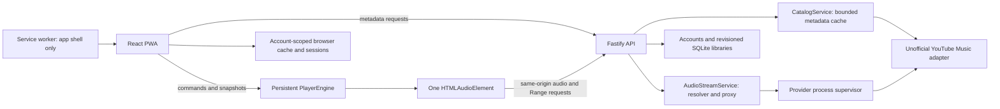

# Architecture

MusicBit is a TypeScript monorepo: a React PWA, a Fastify API and shared contracts.

## Application lifetime and playback

`apps/web/src/main.tsx` creates one audio element and the player engine before mounting React. The engine owns listeners, queue, playback state and Media Session. React subscribes with `useSyncExternalStore`; routing does not own the audio element.

Play commands call `audio.play()` synchronously in the user gesture. The browser requests a same-origin audio URL; backend resolution happens behind that URL without an awaited frontend request. Command generations prevent stale play promises from overwriting newer state.

Manual queue entries and repeat take precedence over autoplay. Recommendations are fetched and staged before the current track ends; the end event consumes only already available tracks. Starting a playlist at an intermediate track preserves the whole collection and selects its index.

Session persistence saves queue metadata, index, position, repeat and autoplay settings. A reload restores a paused session; the first explicit Play resumes it. Local storage does not contain audio or signed upstream stream descriptors.

Native end events handle normal streams. The narrowly scoped fallback for doubled proxy durations uses known metadata, a ratio check and a one-second grace period. The MP4 compatibility patch handles a verified AAC edit-list pattern without changing sample data or byte offsets. See the [playback audit](product-audit.md) and audio regression tests.

## API and provider boundary

The main API registers:

| Route                                | Purpose                                         |
| ------------------------------------ | ----------------------------------------------- |
| `GET /health`                        | Process health                                  |
| `GET /api/tracks`                    | SoundHelix diagnostics/demo catalog             |
| `GET /api/providers`                 | Provider availability                           |
| `GET /api/feed`                      | Discovery shelves                               |
| `GET /api/search`                    | Search one category with a bounded result limit |
| `GET /api/catalog/youtube/:kind/:id` | Track, artist or album details                  |
| `GET /api/recommendations/:id`       | Related tracks for staged autoplay              |
| `GET/HEAD /api/audio/:id`            | Resolve and proxy audio, including HTTP Range   |

Shared runtime validators reject malformed identifiers, URLs and response metadata. Catalog requests use bounded TTL/LRU storage, single-flight work, timeouts and cancellation per subscriber. The metadata gateway permits only its expected search/browse/next endpoints.

The separate playback adapter resolves streams, prefers AAC-LC/m4a and keeps signed descriptors in expiring memory caches. The proxy handles Range, HEAD, stale descriptors, upstream errors and client disconnection. Upstream signed URLs stay behind the API.

Audio resolution now executes upstream player/integrity code in a separate supervised process. The child receives video IDs over IPC, has a minimal environment, a 256 MB V8 heap limit and deadlines, and is recycled when idle or after bounded work. Node permissions deny filesystem writes and process creation; SQLite and native addons are disabled. This is defense in depth, not a full hostile-code sandbox; see [SECURITY.md](../SECURITY.md).

## Interface state

Home, search and library stay mounted while switching primary sections. Scroll positions, search results and library filters survive navigation. Player and queue are secondary views with close/back behavior; the persistent mini-player opens the full player.

Search combines three bounded category requests, tolerates partial failures and exposes category filters. Superseded requests are aborted and stale responses cannot replace newer results. Recent queries are recorded only on submit or result selection/play and can be deleted.

The library uses a versioned, validated local model for favorites, playlists, recent listening, saved albums and followed artists. Playlist menus separate listening from editing. Reordering supports drag and directional buttons; undo reinserts a removed track without overwriting later edits.

Guest data remain per browser. Signed-in libraries use SQLite and revision-checked writes; polling/focus/connectivity updates synchronize devices. Conflicts preserve both versions until an explicit choice; there is no automatic merge. Account-specific request headers prevent cross-tab account changes from mixing libraries. JSON backups and guest import are available. Playback queues and recent searches remain scoped to account and browser. Shareable detail URLs remain planned. See [account contracts and operations](accounts.md).

## PWA and serving

Workbox precaches the application shell and bundled static assets. It does not cache API or media responses, handle audio Range requests or control the lifetime of playback. Updates are prompted to avoid unexpected replacement during a session.

Vite proxies API requests in development and preview. Docker uses Nginx for static files and API forwarding; an optional Caddy overlay supplies TLS. Default Compose binds the web port to loopback.

## Tests and experiments

Unit tests cover playback state, validation, persistence, provider seams, cache behavior and audio proxy handling. Playwright uses generated PCM/WAV fixtures served over HTTP to exercise real browser media pipelines in Chromium and WebKit. Offline tests run against the production PWA build.

Optional scripts probe the live provider separately. Those probes do not establish physical iPhone behavior or a performance SLA.

`experiments/` contains separate playback laboratories and audit reproducibility scripts. They are not routes in the main PWA. Earlier architectural milestones are preserved in [architecture history](architecture-history.md) and [development notes](development-notes.md).
