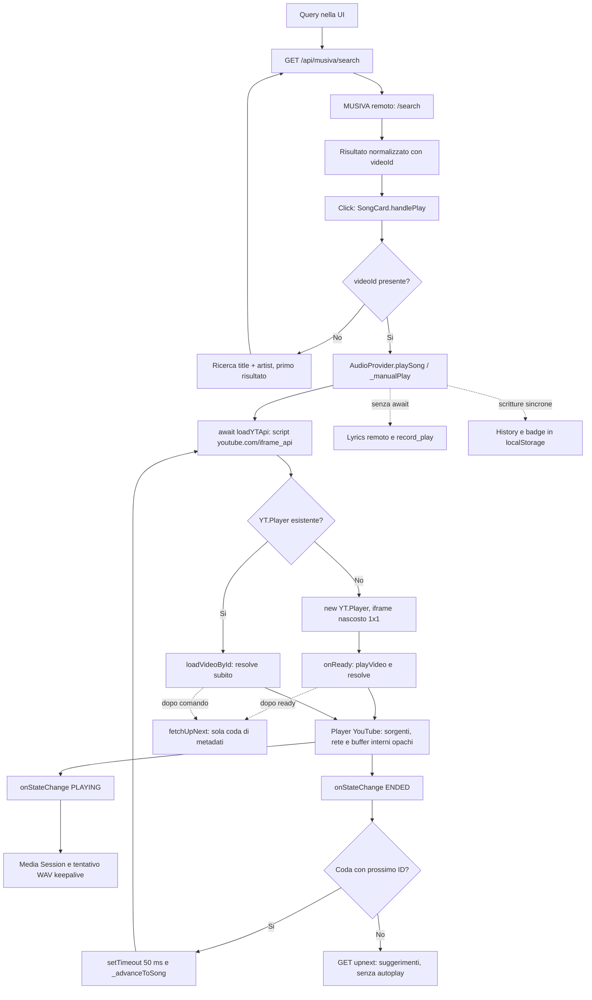
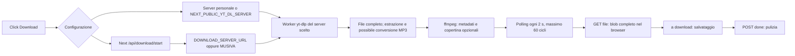

# Musicanaz: audit del codice e confronto con MusicBit M5

Data: **10 ottobre 2026**. Repository analizzato: [Wilooper/Musicanaz](https://github.com/Wilooper/Musicanaz).
Commit: **`e231b69a2f11abe72f66073c55a4ddbcc0f9812b`**, messaggio `Update README.md`,
data del commit `2026-08-08T19:05:49+05:30`.

**Verdetto: riutilizzare alcune idee; non adottare il motore audio.** Musicanaz
suona attraverso un **player YouTube IFrame nascosto, di 1 × 1 pixel**. Non
collega YouTube.js a un `HTMLAudioElement` musicale. Il suo elemento `<audio>`
React resta senza sorgente; un secondo elemento audio riproduce un WAV senza
campioni come tentativo di keepalive. Questo non risolve né dimostra il requisito
MusicBit di playback YouTube nativo affidabile su iPhone. [A1], [A2], [A3], [A4], [A65]

## 1. Metodo, perimetro e riproducibilità

Clone separato, eseguito con `git clone --depth 1 --no-tags`:
`../musicbit-audits\Musicanaz`.
SHA verificato con `git rev-parse HEAD`. La shallow clone consente l'analisi di
questa fotografia, non della storia precedente. Tutti i riferimenti **A** in fondo
puntano a file e righe di questo SHA; i riferimenti **M** puntano ai file locali
MusicBit effettivamente letti.

Confronto MusicBit: branch locale `codex/m5-youtube-playback`, HEAD
`d180cf94cde1546819a575051076f0187c81bfe6`, **working tree con modifiche M4/M5 già
presenti**. Il confronto comprende queste modifiche, non soltanto HEAD. Prima
dell'audit sono stati registrati SHA-256 dei file tracciati e non ignorati già
presenti. L'unico file aggiunto a MusicBit da questo audit è questo report;
nessun file applicativo, player, configurazione o precedente report è stato modificato.
Nessun checkout di branch, commit, push o PR.

Sono state lette le implementazioni del contesto audio, degli ingressi di
riproduzione, ricerca, code, Media Session, service worker, proxy Next e dei due
download server. La ricerca globale degli usi distingue il codice attivo dalle
sole definizioni. I file `.bak`, `build.py` e `patch.py` non sono entry point degli
script npm e non sono stati eseguiti; questi ultimi riscrivono sorgenti. Il
backend remoto MUSIVA/ytdata non è contenuto nel clone: la sua implementazione,
cache, estrattori e infrastruttura rimangono **non verificabili da questo codice**.
[A5], [A6], [A7], [A8], [A9], [A86]

Verifiche eseguite fuori da MusicBit:

- **14 assert superati** su sorgenti reali trasposte con TypeScript, montando
  `AudioProvider` in React/jsdom e sostituendo SDK YouTube, storage e trasporti
  con mock; anche gli handler dei proxy sono eseguiti con `fetch` simulato.
- **4 tentativi media desktop** con il WAV del progetto e PCM originale di
  controllo: risultati e limiti nella sezione 7.
- **`pnpm audit --json` sul lockfile del clone**: uscita 1 per advisory rilevati,
  non per un errore di esecuzione; nessuna correzione automatica.
- Inventario degli usi con `rg`, verifica SHA, integrità dei file preesistenti e
  controllo finale dei riferimenti alle righe.

Nessuna installazione delle dipendenze Musicanaz, esecuzione della sua build,
prova su un deployment pubblico, estrazione/download YouTube o richiesta a
MUSIVA, ytdata e proxy media reali. L'harness riusa in sola lettura dipendenze
locali disponibili: Node 24.14.0, TypeScript 5.9.3, React/ReactDOM 19.3.0,
jsdom 30.1.2, Playwright 1.64.0. **Non è una verifica della build Musicanaz con le
sue dipendenze React 19.2.0**, né della rete o SDK YouTube reale. [A5]

## 2. Percorso audio effettivo

Riferimenti del diagramma: ricerca e fallback [A6], [A10], [A11]; selezione e
operazioni laterali [A12], [A13]; loader/player [A2], [A3]; coda e fine brano
[A14], [A15]; Media Session e keepalive [A4], [A16]. Il nodo remoto è deliberatamente
opaco: il repository non espone richieste interne, codec, buffer o URL firmati
del player YouTube.

Il nome `/api/musiva/play/[videoId]` trae in inganno: restituisce **JSON di
playlist o brano**, provando fino a tre richieste remote seriali. Anche
`/api/musiva/stream/[videoId]` restituisce JSON, senza inoltrare audio al player;
non è richiamato dal percorso di riproduzione analizzato. [A7], [A8], [A3], [A12]

Il percorso di download è separato:

I worker disegnati sono dimostrati per i server **inclusi**; non conosciamo
l'implementazione del server remoto selezionato. I byte scaricati non vengono
passati al player. La UI salva un record `audioUrl: ""`. L'elenco di istanze
Invidious e i commenti sui tier rimangono nel file, ma `handleDownload` attivo
non li usa. `/api/download/proxy` è comunque una route esposta. [A17], [A18], [A19], [A20]

## 3. Mappa di file, funzioni e responsabilità

| File e righe                                                                            | Funzioni / responsabilità realmente osservate                                                                                                                                                            |
| --------------------------------------------------------------------------------------- | -------------------------------------------------------------------------------------------------------------------------------------------------------------------------------------------------------- |
| `app/page.tsx:1026–1108`, `app/api/musiva/suggestions/route.ts:4–24`                    | `fetchSuggestions`, debounce 280 ms; `executeSearch`, filtri e risultati React; suggerimenti delegati a MUSIVA. Il debounce riguarda suggerimenti, non l'esecuzione completa della ricerca. [A21], [A80] |
| `app/api/musiva/search/route.ts:4–30`                                                   | `GET`: proxy dei metadati verso MUSIVA; normalizzazione array/oggetto. Nessun provider YouTube.js nel processo Next. [A6], [A5]                                                                          |
| `app/api/musiva/video/search/route.ts:4–17`                                             | `GET`: variante `filter=videos`, ancora delegata a MUSIVA. [A22]                                                                                                                                         |
| `components/song-card.tsx:21–67`, `app/page.tsx:83–96,279–291`                          | `handlePlay`, `resolveVideoId`: selezione, eventuale ricerca aggiuntiva, `playSong`, navigazione. [A10], [A11]                                                                                           |
| `lib/audio-context.tsx:68–83`                                                           | `loadYTApi`: carica SDK globale, risolve callback in attesa. [A2]                                                                                                                                        |
| `app/layout.tsx:200–204`, `lib/audio-context.tsx:131–162,205–230,1045–1060`             | Provider persistente nel layout; ref al player YouTube, audio React inerte, audio keepalive creato una volta per mount. [A1], [A4], [A23]                                                                |
| `lib/audio-context.tsx:472–598`                                                         | `loadVideo`: crea o riusa `YT.Player`, eventi ready/state/error, fine brano. [A3], [A15]                                                                                                                 |
| `lib/audio-context.tsx:603–743`                                                         | `_advanceToSong`, `_manualPlay`, `playSong`: reset dello stato, lyrics/history, scelta ID, avvio SDK/video. [A12], [A13], [A24]                                                                          |
| `lib/audio-context.tsx:745–787,943–1043`                                                | `playNext`, `playPrev`, `togglePlayPause`, `seek`, `stopSong`, `playPlaylist`, `_manualPlayWithQueue`, rimozione/riordino. [A25], [A26]                                                                  |
| `lib/audio-context.tsx:232–310,628–651`                                                 | `syncLyrics`, polling 500 ms, stop-at, fade di volume; non buffer/preload di un secondo brano. [A27], [A28]                                                                                              |
| `lib/audio-context.tsx:312–395`                                                         | Metadata, action handler Media Session e visibility callback. [A16], [A29]                                                                                                                               |
| `lib/audio-context.tsx:418–470`                                                         | `loadLyrics`: timeout 45 s; `fetchUpNext`: sola coda, refresh forzato. [A14], [A30]                                                                                                                      |
| `components/mini-player.tsx:10–33,82–115`, `app/player/page.tsx:341–427,438–456`        | UI e deep link; usano il contesto, non creano il player musicale. Metadata da link possono causare un nuovo `playSong`. [A31], [A32]                                                                     |
| `app/playlist/page.tsx:43–105`, `app/library/page.tsx:100–110`                          | Caricamento playlist con fallback seriali; Play All inserisce coda esplicita. [A33], [A34]                                                                                                               |
| `app/album/page.tsx:59–81`, `app/artist/page.tsx:180–197`, `app/podcast/page.tsx:28–81` | Altri ingressi a `playSong`; Play All album avvia solo il primo brano; podcast senza coda musicale automatica. [A35], [A36], [A37]                                                                       |
| `app/api/musiva/{song,playlist,album,upnext}/route.ts`                                  | `GET` verso endpoint remoti corrispondenti; upnext supporta anche DELETE. Nessun audio trasportato da questi handler. [A38], [A72], [A73], [A74]                                                         |
| `app/api/musiva/{artist,artist-songs,artist-albums,related-songs}/route.ts`             | Altri proxy di catalogo/relazioni, senza un resolver di byte audio locale; album artista con revalidate 600 s. [A75], [A76], [A77], [A81]                                                                |
| `app/api/musiva/play/[videoId]/route.ts:4–19`, `stream/[videoId]/route.ts:4–15`         | JSON di playlist/brano e JSON di stream remoto, distinti dal motore iframe. [A7], [A8]                                                                                                                   |
| `lib/storage.ts:120–134,141–165,314–318`, `lib/store/index.ts:30–41,82–101`             | Cache dichiarata e record download, playlist/history, letture/scritture JSON sincrone. `getCachedSongUrl`/`addToCached` non hanno consumatori nel playback attivo. [A39], [A40], [A85]                   |
| `public/sw.js:35–90`                                                                    | Cache shell/statici; esclude API e host YouTube/Google. Non riproduce né prepara musica. [A41]                                                                                                           |
| `lib/yt-client.ts:15–49`, `app/api/ytdata/[...path]/route.ts:5–50`                      | Feed personale/record_play con payload cookie condizionale; proxy JSON verso servizio esterno. [A42], [A43]                                                                                              |
| `app/player/page.tsx:845–953`, `app/api/download/{start,status,file,done}/…`            | `executeDownload`, `handleDownload`, proxy a sessioni di download. [A17], [A18], [A44], [A87], [A88], [A89]                                                                                              |
| `app/api/download/proxy/route.ts:6–57`                                                  | `GET`: inoltra un URL arbitrario come attachment, senza allowlist. [A19]                                                                                                                                 |
| `download_server.js:130–350,365–455`                                                    | `checkYtdlp`, `startDownload`, `embedMetadata`, handler HTTP: processi yt-dlp/ffmpeg, file temporanei e sessioni. [A20], [A45], [A46]                                                                    |
| `download_server.py:123–338,438–533`                                                    | Variante Python: `_run_download`, `_embed_metadata`, thread worker, stessi endpoint e file completi. [A47], [A48], [A49]                                                                                 |
| `lib/audio-context.tsx:789–904`, `app/party/[id]/page.tsx:122–202,495`                  | Party via polling HTTP, aggiornamento coda host e click per ascoltare localmente. Nessun trasporto audio condiviso. [A50], [A51], [A84]                                                                  |
| `lib/party-rtc.ts:21–39,73–88,112–119,180–200`                                          | Classe di data channel JSON, senza tracce audio; nessun import della classe nell'app attiva trovato. [A52]                                                                                               |
| `app/note/page.tsx:136–187,230–237`                                                     | Secondo player YouTube specifico per Note, nascosto e distrutto all'unmount, con loader globale separato. [A53]                                                                                          |

## 4. Prestazioni: dal click all'audio

### 4.1 Catena seriale e operazioni concorrenti

**Risultato già dotato di video ID:** `SongCard.handlePlay` chiama `playSong`;
`_manualPlay` modifica stato e storage, poi attende SDK e `loadVideo`. Al primo
avvio si aggiungono download/esecuzione dello script e inizializzazione iframe;
ai successivi `loadVideoById` riusa l'iframe ma carica un altro contenuto. La
Promise warm si risolve subito dopo il comando; la Promise cold si risolve a
`onReady`, **nessuna delle due attende PLAYING**. `isLoading=false` pertanto non
misura l'avvio dell'audio. [A10], [A12], [A3]

**Risultato senza video ID:** si aggiungono in serie browser → Next search →
MUSIVA → risposta → primo risultato → avvio iframe. È un fuzzy match di titolo
e artista, senza verifica d'identità/diritti; può scegliere un'altra registrazione.
Paste & Play attende analogamente `/api/musiva/song` prima di chiamare il player.
[A10], [A11], [A54]

Lyrics e `recordYTPlay` sono avviati senza `await`; la ricerca upnext parte dopo
ready/comando. Non costituiscono attese seriali necessarie al primo audio, ma
aggiungono richieste, parsing/render e scritture. History, badge e dati sul brano
precedente passano invece da JSON/localStorage **sincroni prima degli await**.
Non è stata misurata una loro incidenza significativa: è un costo potenziale,
non una causa dimostrata di secondi di ritardo. [A12], [A13], [A30], [A40], [A55]

**Playlist:** `fetchPlaylist` prova fino a quattro endpoint Next in serie; i
due fallback `/play` possono ciascuno provare tre upstream. Limite strutturale
nel caso di tutti i tentativi: **4 richieste browser e fino a 8 upstream**;
senza prefisso VL alcune sono identiche. Mancano timeout/cancellazione in questi
handler. Play All, dopo aver ottenuto i metadati, inserisce la lista senza un
nuovo upnext. [A33], [A7], [A38], [A26]

**Ricerca AI:** esiste un ramo `await aiPersonalizedSearch` → eventuale ricerca
normale, con timeout client 15 s e backend 12 s. Tuttavia `executeSearch` è
memoizzato con dipendenze `[]` e cattura `aiEnabled=false` del primo render:
il normale toggle non aggiorna quel valore nella callback. Non attribuiamo
quindi questo ritardo al percorso search realmente attivo; è un difetto del
ramo previsto, che diventerebbe seriale correggendo la closure. [A21], [A56], [A70], [A71]

Il debounce cancella il timer pendente, non le richieste già partite. Suggerimenti
e ricerche non hanno abort o token di generazione: una risposta vecchia può
sovrascrivere risultati più recenti. L'API search inoltra filter/limit/offset
senza validazione di enum o bounds; la query non ha un limite di lunghezza
applicato qui. L'entità del costo remoto resta ignota. [A21], [A6], [A80]

### 4.2 Cache e preparazione realmente presenti

| Meccanismo              | Stato verificato e conseguenza                                                                                                                                                                                                                                                                |
| ----------------------- | --------------------------------------------------------------------------------------------------------------------------------------------------------------------------------------------------------------------------------------------------------------------------------------------- |
| SDK / iframe            | `ytApiReady` evita il reload dello script dopo la prima inizializzazione; `loadVideoById` riusa il player. Vantaggio di inizializzazione, non cache del prossimo audio. [A2], [A3]                                                                                                            |
| Stato `isCached`        | True soltanto nell'onReady iniziale; viene rimesso false ai cambi, mentre il riuso non lo rimette true. Non attesta byte o prontezza della traccia. [A3], [A24], [A12]                                                                                                                        |
| `CachedSong` in storage | Campi `audioUrl`, `audioBlob`, `cachedAt` e funzioni esistono, ma non vengono letti dal contesto/player per suonare; nessun TTL applicato a questi URL. [A39], [A1], [A3]                                                                                                                     |
| Download salvati        | `audioUrl` vuoto dopo il salvataggio del file; libreria dei record non equivale a playback offline. [A18], [A39]                                                                                                                                                                              |
| Next Data Cache         | Opzioni esplicite `revalidate`: video-info/SponsorBlock 3600 s, alcuni feed 600/1800 s. Nessuna cache audio e nessun single-flight/TTL applicativo nel search/upnext analizzato; non attribuiamo cache del servizio remoto al frontend. [A57], [A58], [A6], [A14], [A72], [A77], [A78], [A79] |
| UI risultati            | `handleFilterChange` riusa risultati già presenti per filtro in memoria React; nuova ricerca li resetta. Non è una cache TTL per query, né deduplica richieste concorrenti. [A21]                                                                                                             |
| Testi AI trasformati    | localStorage con scadenza 7 giorni; riguarda righe di testo, non sorgenti audio. [A59]                                                                                                                                                                                                        |
| Service worker          | Shell/statici; API e YouTube esclusi, nessuna preparazione musicale. In activate elimina tutte le cache dell'origine con nome diverso da `musicanaz-v2`, non soltanto le proprie versioni precedenti: attenzione a eventuali altre app sulla stessa origine. [A41], [A90]                     |
| Prossimo brano          | Coda di ID/metadati anticipata; nessun `cueVideoById`, secondo player preparato, fetch dei byte audio o preload musicale nell'engine. Ogni cambio chiama `loadVideoById`. [A14], [A15], [A24], [A3]                                                                                           |
| “Crossfade”             | Fade-out/fade-in sequenziali del volume dello stesso player, polling 500 ms e passi 200 ms; non sovrappone due tracce, non elimina la nuova inizializzazione media. [A27], [A28]                                                                                                              |

### 4.3 Colli di bottiglia e punti fragili

| Priorità | Evidenza                                                                                                                     | Impatto / limite della conclusione                                                                                                                                           |
| -------- | ---------------------------------------------------------------------------------------------------------------------------- | ---------------------------------------------------------------------------------------------------------------------------------------------------------------------------- |
| Alta     | Loader privo di `onerror`, timeout e reset; `_manualPlay` ignora nuovi comandi durante loading. [A2], [A12]                  | SDK bloccato può lasciare spinner/lock indefiniti. Riprodotto nell'harness senza rispondere al callback SDK; osservazione 100 ms, assenza di deadline dimostrata dal codice. |
| Alta     | Risoluzione del video aggiuntiva o attesa metadati da link. [A10], [A11], [A54]                                              | RTT e tempo MUSIVA prima dell'iframe; costo reale non misurato.                                                                                                              |
| Alta     | Iframe nascosto, avvio dopo await/onReady e nessun `onAutoplayBlocked`. [A2], [A3]                                           | Autoplay/attivazione utente possono fallire su Safari; non provato su iPhone.                                                                                                |
| Alta     | BUFFERING imposta `isPlaying=true`; `onError` scarta evento e risolve la Promise. [A15]                                      | UI/Media Session possono annunciare playing senza audio; errori non spiegati. Confermato con eventi SDK simulati.                                                            |
| Media    | Upnext senza abort/token, può sostituire coda/index/owner dopo un'altra selezione. [A14], [A26]                              | Rischio di risposta vecchia che sovrascrive una playlist nuova; derivato dal codice, non da prova di rete reale.                                                             |
| Media    | Lyrics senza cancellazione della precedente richiesta; timeout cancellato prima del parsing JSON. [A30]                      | Risposte vecchie possono cambiare lyrics del nuovo brano; il limite non copre tutta la lettura/parsing del body.                                                             |
| Media    | `playNext` sposta index prima del controllo loading dentro `_advanceToSong`. [A25], [A24]                                    | Comando scartato può lasciare index e brano non allineati durante inizializzazione.                                                                                          |
| Media    | Fine brano → timer esplicito 50 ms → nuova sorgente iframe. [A15], [A3]                                                      | Ritardo applicativo aggiunto, poi rete/buffering opachi. Timer eventualmente sospendibile in background.                                                                     |
| Media    | Fade-out usa timer locale non incluso nella cleanup del polling; fade-in porta il volume a zero dopo loadVideo. [A27], [A28] | Possibili timer che agiscono sulla traccia successiva e silenzio aggiuntivo con fade abilitato; non misurati su dispositivo.                                                 |
| Bassa    | Artwork via `images.weserv.nl` in tre taglie, metadata ricreati su currentSong/isPlaying. [A16]                              | Dipendenza di rete per copertine, senza await nel percorso critico; non prova di ritardo al primo audio.                                                                     |

Non esistono misure `performance.now`, `loadstart`, `loadeddata`, `buffered`,
`readyState` o Resource Timing nel percorso musicale Musicanaz. I tempi di
risoluzione stream, primo byte, decodifica e playing non possono essere ricavati
retroattivamente da `isLoading`/`isCached`. L'iframe cross-origin non espone il
proprio `HTMLMediaElement` all'app; questa riceve stati dell'SDK. Non si può
separare frontend/server remoto/buffering con la telemetria attuale. [A3], [A15], [A23]

### 4.4 Processi esterni e conversioni: solo download

Il player musicale non avvia processi server. I downloader opzionali avviano
yt-dlp (`spawn` Node o `Popen` Python) con estrazione audio e formato MP3
predefinito: se il codec di partenza differisce, richiede conversione tramite
ffmpeg. La successiva incorporazione dei metadati usa `-codec:a copy`, evitando
un'ulteriore ricodifica audio, ma attende controllo ffmpeg, eventuale copertina
e comando di tagging prima di `ready`. Non è una strategia di streaming rapido:
UI e server aspettano un file completo. [A20], [A45], [A47], [A48], [A17], [A82], [A83]

Il polling introduce una granularità di 2 s e il browser legge poi tutto il blob
prima del salvataggio. I subprocess yt-dlp non hanno deadline/cancellazione;
gli ffmpeg hanno timeout 90 s, le copertine 10 s. Non abbiamo eseguito questi
processi né attribuiamo i loro costi all'avvio dell'iframe. [A17], [A20], [A45], [A47], [A48]

## 5. Fine brano, background, Media Session e iOS

### 5.1 Cambio automatico esatto

1. L'evento è **`YT.Player.onStateChange` con `YT.PlayerState.ENDED`**, non
   `ended` dell'audio React. Vengono azzerati tempo/isPlaying e ripristinato il volume. [A15]
2. Legge `queueRef`/`queueIndexRef`, incrementa l'indice e, se disponibile,
   programma `_advanceToSong(nextSong)` dopo **50 ms**. [A15]
3. `_advanceToSong` aggiorna currentSong, avvia lyrics/history e attende
   `loadYTApi` e `loadVideo`. Anche quando l'SDK è pronto, l'`await` rinvia il
   seguito alla microtask queue. Non richiede un nuovo `/stream` o upnext
   nel normale avanzamento di una coda già pronta. [A24], [A3]
4. `loadVideoById` cambia il video nello stesso `YT.Player`. **Non cambia `src`
   dell'audio React, ma cambia il contenuto media interno all'iframe**: ulteriori
   richieste YouTube e buffering restano necessari e non sono osservati qui.
   In caso di errore sincrono del riuso, il codice svuota il container e crea
   un nuovo `YT.Player`, senza chiamare `destroy` sul vecchio. [A3]
5. Se la coda è finita, esegue un upnext remoto e mostra fino a cinque
   suggerimenti soltanto se presenti. **Non li riproduce automaticamente**.
   `playFromSuggestions` richiede un'azione e richiama `playPlaylist`. [A15], [A60]

La selezione manuale svuota la coda e usa `queueIndex=-1`; l'upnext diventa la
lista futura e il primo ENDED prende l'elemento 0. Una playlist esplicita parte
invece con indice 0 (o startIndex) e non richiede upnext. I podcast manuali non
costruiscono questa coda musicale. Play All album, diversamente da Play All
playlist, passa soltanto il primo brano a `playSong`: proseguirà con upnext,
non necessariamente con il resto dell'album. [A12], [A14], [A26], [A35]

### 5.2 Cosa fa il tentativo di background

Il layout mantiene il provider durante la navigazione Next; il player iframe
rimane nel DOM fuori schermo. Il WAV viene creato al mount con `new Audio`,
`loop=true`, volume 0,001, avviato in risposta allo stato PLAYING o al comando
Media Session play, e fermato nello stato PAUSED. I fallimenti `.play()` sono
ignorati. Il commento lo descrive per Android: **non è un'implementazione
dimostrata di background iOS**. Il WAV contiene 44 byte di header e zero byte
PCM; durata 0 osservata in Chromium. [A1], [A4], [A15], [A16]

Il listener `visibilitychange` agisce solo tornando visibili: legge lo stato
PAUSED del player ma il ramo che dovrebbe riprendere YouTube è vuoto. Tenta
soltanto di riavviare l'audio keepalive, anche senza verificare l'intenzione di
ascolto. Nessuna prova che preservi l'iframe quando Safari sospende la pagina;
nessuna gestione audio background nel service worker. [A29], [A41]

### 5.3 Media Session

Titolo/artista/album/artwork vengono pubblicati con feature detection; play,
pause, previous, next e seekto sono registrati con try/catch per singola azione.
Seek forward/backward vengono esplicitamente rimossi per una scelta UI Android.
Posizione aggiornata mediante polling 500 ms, se durata/tempo sono disponibili.
È un collegamento comandi/metadati, **non una garanzia di esecuzione JS in
background o di CarPlay**. [A16], [A27]

BUFFERING è equiparato a isPlaying; metadata possono indicare playing durante
l'attesa. `stopSong` cancella currentSong ma l'effetto metadata esce senza
azzerare `navigator.mediaSession.metadata` o aggiornare playbackState; anche il keepalive non viene
esplicitamente fermato da `stopSong`. Sono lacune del lifecycle, non prove di
come iOS presenterà concretamente il lock screen. [A15], [A16], [A26]

### 5.4 Accorgimenti presenti e verifiche mancanti

`playsinline:1`, provider persistente, gestione Media Session e riuso dell'iframe
sono presenti. Mancano una procedura di attivazione sincrona del vero media
prima degli await, gestione `onAutoplayBlocked`, telemetria di buffering e
registrazione degli eventi freeze/pagehide/pageshow nell'engine. Un deep link
può chiamare `playSong` da un effetto anziché da un gesto. Questi sono rischi
Safari dedotti dal percorso, non fallimenti misurati su iPhone. [A3], [A12], [A32]

La documentazione [WebKit sulle policy iOS](https://webkit.org/blog/6784/new-video-policies-for-ios/)
spiega che `playsinline` riguarda il fullscreen e distingue le condizioni di
autoplay dalla riproduzione avviata dall'utente. È documentazione storica di iOS
10, non una certificazione del comportamento corrente a schermo bloccato.
La [IFrame API](https://developers.google.com/youtube/iframe_api_reference#onAutoplayBlocked)
documenta un evento specifico per playback bloccato dal browser, assente in
Musicanaz. Non basta attendere `onReady` per mantenere un gesto valido.

La pagina Note è un'eccezione alla persistenza unica: contiene un secondo
player. L'effetto inizializzatore dipende da `[videoId]` ma esce quando
`started=false`; il click che cambia solo `started` non lo riesegue. Il loader
separato sovrascriverebbe inoltre `window.onYouTubeIframeAPIReady`, se attivato
durante un altro caricamento. Difetti rilevati nel codice; non usati per
concludere che il player principale crei un nuovo audio a ogni brano. [A53]

**Stato delle prove fisiche Musicanaz: non eseguite** per Safari, PWA Home,
lock screen, cambio automatico bloccato, interruzioni e CarPlay. Il codice
dimostra il tentativo di mantenere attivo un iframe, non il risultato.
Le conferme MusicBit M2 dell'utente rimangono circoscritte alle sorgenti demo
allora provate; CarPlay e il motore YouTube M5 restano non validati. [M8], [M9]

## 6. Errori, scadenze e sicurezza dei servizi

### 6.1 Errori e validità delle sorgenti

`onError: () => … resolve()` scarta completamente il codice SDK, non espone un
campo errore nel contesto, non prova skip/recupero e non distingue privato,
embedding vietato o autoplay. Le eccezioni JavaScript vengono scritte con
`console.error` grezzo, mentre diversi fetch sono silenziati o restituiscono
array vuoti/500 generici. [A15], [A12], [A24], [A14], [A6]

La [documentazione IFrame](https://developers.google.com/youtube/iframe_api_reference#onError)
distinge codici come 100 (video assente/privato), 101/150 (embedding vietato),
153 (identificazione client mancante) e altri errori del player. **Non sono
status HTTP 403/429**. Musicanaz non li conserva. Il proxy download inoltra gli
status non-ok ma non analizza `Retry-After` o rinnova sorgenti. [A15], [A19]

Non esiste un contratto di sorgente con MIME, durata di validità, permesso e
stato disponibile: `Song` conserva ID/metadati. Il player ufficiale gestisce
internamente gli URL; il loro TTL non è ispezionabile qui. Le funzioni storage
non controllano scadenza; il TTL di un'ora dei downloader riguarda **sessioni e
file locali**, non la firma di un URL YouTube. Nessuna conclusione su quanto
vivano davvero gli URL del servizio può derivare dal clone. [A61], [A39], [A82], [A83]

### 6.2 Rischi dei proxy e downloader

| Gravità di audit | Problema dimostrato dal codice                                                                                                                                   | Conseguenza e portata                                                                                                                                                                                                                            |
| ---------------- | ---------------------------------------------------------------------------------------------------------------------------------------------------------------- | ------------------------------------------------------------------------------------------------------------------------------------------------------------------------------------------------------------------------------------------------ |
| Alta             | `/api/download/proxy` accetta `url` arbitrario, decodifica una seconda volta, esegue fetch con redirect predefiniti, senza allowlist di schema/host/IP. [A19]    | Superficie SSRF/open proxy: loopback, reti interne e redirect non esclusi dall'app. Harness conferma accettazione di URL loopback con fetch finto; **nessuna intrusione/scansione di reti reali**. Egress del deployment può limitare l'impatto. |
| Alta             | Nessuna autenticazione/rate limit/limite dimensioni/timeout o segnale client nel proxy generico. [A19]                                                           | Potenziale abuso di banda/connessioni e accesso involontario a servizi interni. L'edge runtime non elimina i limiti del provider, nonostante il commento “no Vercel timeout”.                                                                    |
| Media            | Range non inoltrato, Content-Range/Accept-Ranges non conservati e risposta di successo sempre 200, anche da upstream 206. [A19], [A88]                           | Endpoint non pronto per seek/streaming progressivo robusto. Confermato con risposta 206 simulata. **Non spiega** il buffering del player iframe, che non lo usa.                                                                                 |
| Alta             | Downloader HTTP su `0.0.0.0`, CORS permissivo, endpoint senza auth, body senza limite e worker senza limite di concorrenza. [A46], [A49], [A82], [A83], [A91]    | Esposizione pubblica permette consumo CPU/disco/processi; CORS restringe browser, non autorizza chiamanti. UID casuale 96 bit rende difficile indovinare una sessione, non protegge start da abusi.                                              |
| Alta             | `thumbnail` arbitrario viene richiesto dal server; Node senza filtro host/IP, Python `urllib.request` senza allowlist e con redirect. [A45], [A48], [A46], [A49] | Ulteriore superficie SSRF e consumo di memoria/disco per copertine; sfruttabilità dipendente dalla rete. Non testata contro host reali.                                                                                                          |
| Media            | yt-dlp senza timeout/kill su done o TTL; cleanup elimina solo il file noto alla sessione. [A20], [A46], [A47], [A49], [A82], [A83]                               | Worker lunghi e file parziali possono sopravvivere; chiudere il polling UI non cancella il lavoro server.                                                                                                                                        |
| Media            | `/api/ytdata` concatena il path e omette la query originaria. [A43]                                                                                              | `record_play?v=…` e `related?v=…` perdono il video ID upstream; confermato sul vero handler con trasporto finto. Proxy senza allowlist di azioni, anche se il server base è fissato dall'operatore.                                              |

Le chiamate download dirette inviano titolo/artista/album/thumbnail; il proxy
Next start inoltra **solo video_id**, quindi il tagging può perdere i metadati
disponibili nella UI. Start/status hanno timeout 15/10 s; file/done non lo hanno
e non propagano la cancellazione del client al fetch upstream. [A17], [A44], [A87], [A88], [A89]

### 6.3 Cookie, dati personali e servizi esterni

`saveCookies` usa base64, non crittografia. `SafeStore` è soltanto un namespace
di localStorage accessibile agli script della pagina. Se `hasCookies()` è true,
il payload viene inviato al servizio ytdata tramite Next: il commento del
SafeStore “never exported” non descrive questo percorso. Nessun cookie reale
è stato usato nell'audit. [A42], [A40], [A43]

Importante limitazione: `hasCookies` richiede anche `yt_enc_key`, ma `saveCookies`
e la UI non lo impostano; `setEncryptionKey` non ha chiamanti nel sorgente
attivo. Con storage nuovo, la UI può annunciare Connected senza rendere true
il controllo del client. La trasmissione dei cookie è quindi **condizionale**,
per esempio a una chiave legacy già presente, non dimostrata dal solo Save
su un'installazione pulita. [A62], [A42], [A63]

Dipendenze di servizio osservate: MUSIVA per ricerca/metadati/upnext, YouTube
per SDK e playback, API lyrics diretta, SponsorBlock per highlight, weserv per
artwork, party esterno, ytdata opzionale e server download configurabile.
Il default MUSIVA nel codice (`turbo-14uz.onrender.com`) differisce dal valore
nel `.env.example` (`shyamsingharoy-musivapi.hf.space`): deployment senza env
e deployment con esempio possono avere prestazioni/disponibilità diverse.
Non sono stati misurati cold start o SLA di questi servizi. [A6], [A3], [A30], [A58], [A16], [A50], [A43], [A44], [A64]

Il layout include **Vercel Analytics e Google Analytics con un ID fisso**.
Self-hosting del frontend non rende automaticamente privato questo insieme
di servizi. La presenza del codice è verificata; eventi e dati effettivamente
trasmessi non sono stati analizzati in una sessione live. [A65]

### 6.4 Dipendenze e verifiche di qualità

Stack reale: Next **16.0.10**, React/ReactDOM **19.2.0**, componenti UI Radix e
altre dipendenze. Nessuna dipendenza `youtubei.js`, motore HLS o libreria audio
dedicata. I server download aggiungono yt-dlp e ffmpeg fuori dal lockfile npm.
[A5], [A20], [A47]

`pnpm audit --json` del **10/10/2026** segnala **67 advisory** sul lockfile:
**3 critical, 34 high, 26 moderate, 4 low**, con 246 dipendenze totali dichiarate
nel risultato. Sono segnalazioni associate a versioni, non 67 exploit provati.
Tra i critici, verificati anche negli avvisi dei manutentori:

| Advisory                                                                                                   | Associazione al clone e limite                                                                                                                                                                                             |
| ---------------------------------------------------------------------------------------------------------- | -------------------------------------------------------------------------------------------------------------------------------------------------------------------------------------------------------------------------- |
| [Next GHSA-p293-qw3h-jr36](https://github.com/vercel/next.js/security/advisories/GHSA-p293-qw3h-jr36)      | Next 16.0.10 ricade nel range della RCE su filesystem Windows, corretta nella serie 16 a 16.3.3. Rilevante per eventuale hosting Windows; nessun exploit eseguito. [A66]                                                   |
| [Next GHSA-2xp9-vwfh-vxw4](https://github.com/vercel/next.js/security/advisories/GHSA-2xp9-vwfh-vxw4)      | RCE nella pipeline AVIF dell'Image Optimization, correzione 16.3.3. `images.unoptimized:true` riduce l'uso ordinario della pipeline dalla UI; non abbiamo dimostrato esposizione/sfruttabilità dell'endpoint. [A66], [A67] |
| [node-tar GHSA-23hp-3jrh-7fpw](https://github.com/isaacs/node-tar/security/advisories/GHSA-23hp-3jrh-7fpw) | tar 7.5.2 nella catena dev Tailwind/oxide, advisory DoS da decompressione, corretto in 7.5.19. Non è un percorso audio né una prova di attacco remoto al player. [A68]                                                     |

I numeri dipendono dal registro degli advisory e possono cambiare. La versione
minima che corregge uno specifico avviso non basta a correggere tutti quelli
del risultato: serve una revisione aggiornata completa prima di riuso/deploy.
La build configura `typescript.ignoreBuildErrors:true`; lo script lint richiama
ESLint ma il pacchetto non lo dichiara. Nessuno script test/typecheck o suite di
test/CI è presente nell'inventario del clone. Non dichiariamo quindi build,
lint o test originali Musicanaz superati. [A5], [A67]

### 6.5 Licenza e condizioni delle sorgenti

La [licenza MIT del clone][A69] permette riuso del software mantenendo notice
copyright e permesso nelle copie/parti sostanziali, senza garanzia. **Non concede
diritti sui brani, sulle miniature, sul marchio YouTube o sui servizi remoti**;
le licenze delle dipendenze vanno considerate separatamente.

Le [YouTube Developer Policies](https://developers.google.com/youtube/terms/developer-policies),
consultate il 10/10/2026, richiedono permesso per API non documentate (III.D.7),
limitano download/cache/offline (III.E.1), separazione audio/video e player
background non visibile (III.I.7–9). Il container fuori schermo e i downloader
di questo codice sono quindi motivi concreti per **non adottare questi percorsi**
senza un'autorizzazione applicabile. [A4], [A20], [A47]

La [IFrame API](https://developers.google.com/youtube/iframe_api_reference#Requirements)
richiede inoltre un viewport almeno 200 × 200: il player 1 × 1 non lo rispetta.
I [termini YouTube](https://www.youtube.com/static?template=terms) impongono
restrizioni all'accesso automatizzato e a download/uso dei contenuti fuori dai
casi consentiti. Una licenza del brano o l'uso personale non documentano da soli
un permesso di accesso diretto alla piattaforma. Sono vincoli da verificare,
non una valutazione giuridica della singola attività di un utente. [A3], [A4]

## 7. Prove locali e misure: cosa è stato dimostrato

Artefatti conservati **fuori da MusicBit**, in
`../musicbit-audits`:

| Artefatto                         | SHA-256                                                            |
| --------------------------------- | ------------------------------------------------------------------ |
| `audit-probes.cjs`                | `70E9105911D3516593BECFBC455BE718A07E79BE5F46504E6232F45267E128B2` |
| `audit-probes-results.json`       | `A0E39966D4E7719A2FE745FFA2B07CA767524D4BF3A6743AB4CD02CE91BF4988` |
| `musicanaz-dependency-audit.json` | `B19976BDE60249CDC4B68E06DD9F69E83066C35EE44FD9024F28971A0F9C2019` |

L'harness carica i file dal clone registrato, non una riscrittura dell'algoritmo.
Esecuzione ripetibile dalla directory audit con `node audit-probes.cjs`, se
restano disponibili le dipendenze locali indicate. I 14 assert verificano:

1. Un audio React senza `src`, più un audio keepalive al mount.
2. Attesa del callback SDK prima di creare il player.
3. `onReady` toglie loading e imposta cached prima di PLAYING.
4. BUFFERING imposta playing anche nella Media Session simulata.
5. ENDED carica il prossimo ID nello stesso player SDK simulato.
6. Nessuna risoluzione stream o modifica del `src` nativo nell'avanzamento.
7. Coda esaurita: fetch di suggerimenti senza riproduzione automatica.
8. Errore iframe 150 scartato e nessun campo error esposto dal contesto.
9. SDK senza risposta: loading rimane true e la seconda selezione viene scartata.
10. Proxy accetta URL loopback, senza connettersi davvero a quel target.
11. Range perso e 206 trasformato in 200 senza Content-Range.
12. Fetch proxy senza segnale di timeout/cancellazione.
13. Proxy ytdata perde la query video ID.
14. WAV keepalive di 44 byte con zero campioni PCM.

Riferimenti corrispondenti: [A1], [A2], [A3], [A4], [A15], [A16], [A19], [A43]. Il trasporto
simulato dimostra controllo/contratti, non streaming YouTube funzionante.

| Misura / prova                               | Risultato osservato                                       | Interpretazione ammessa                                                                                                             |
| -------------------------------------------- | --------------------------------------------------------- | ----------------------------------------------------------------------------------------------------------------------------------- |
| ENDED → chiamata mock `loadVideoById`        | **52,13 ms**, un campione                                 | Conferma il timer di 50 ms nel controllo locale; **non** click → suono o latenza YouTube.                                           |
| Header keepalive                             | 44 byte, PCM 0 byte                                       | Nessun segmento audio di durata positiva da mantenere in loop.                                                                      |
| Chromium desktop, WAV keepalive              | Promise play risolta in 142,7 ms, durata **0 s**          | Promise risolta non prova playback continuo o background.                                                                           |
| Chromium desktop, PCM originale di controllo | Promise play risolta in 27,2 ms, durata **0,5 s**         | Controllo locale, senza media remoto né prova al suono.                                                                             |
| WebKit Playwright Windows, WAV keepalive     | `NotSupportedError`, MEDIA_ERR_SRC_NOT_SUPPORTED 4, 20 ms | Fallimento di quel tentativo desktop, non prova Safari iPhone.                                                                      |
| WebKit Playwright Windows, PCM di controllo  | Stesso errore 4, 25 ms                                    | Anche il controllo fallisce: non attribuire il fallimento WebKit soltanto al file vuoto; supporto media dell'ambiente non validato. |

Le prove browser sono avviate da click con tutte le richieste di rete bloccate.
Il PCM di controllo è silenzio originale generato nell'harness. **Nessuna traccia
YouTube, nessun download o proxy remoto è stato esercitato**. Non sono misure
cold/warm di un servizio, non giustificano percentili e non raggiungono il criterio
di ascolto fisico. Non sono stati calcolati p50/p95 da questi singoli campioni.

Non è stato eseguito un benchmark reale Musicanaz click → audio: non è stata
fornita una sorgente con permessi applicabili al suo percorso nascosto/download,
e simulare PLAYING non sarebbe una prova audio. Rimangono **non misurati**
tempo MUSIVA reale, risoluzione/formati del media, buffering iniziale, cambio
di brano reale, URL expiry e funzionamento su iOS.

## 8. Confronto tecnico con MusicBit M5

| Aspetto              | Musicanaz allo SHA analizzato                                                                        | MusicBit nella working tree letta                                                                                                      | Valutazione                                                          |
| -------------------- | ---------------------------------------------------------------------------------------------------- | -------------------------------------------------------------------------------------------------------------------------------------- | -------------------------------------------------------------------- |
| Motore persistente   | Provider nel layout, iframe YouTube persistente; audio nativo musicale non usato. [A1], [A3]         | Un HTMLAudioElement creato fuori React, engine indipendente dalla schermata. [M1]                                                      | Nessun miglioramento di persistenza da importare.                    |
| Primo avvio          | SDK e player on demand, possibili metadati/fuzzy search seriali, play dopo await. [A2], [A10], [A12] | URL demo già disponibile, assegnazione src/load/play nel percorso sincrono del gesto. [M2]                                             | Sostituire il motore aggiunge dipendenze e punti di attesa.          |
| Preparazione         | Metadati della coda; nessun preload audio del prossimo ID. [A14], [A24]                              | Preparazione esplicita sullo stesso audio in pausa; staging solo descrittori nei lab. [M3], [M17]                                      | Musicanaz non dimostra un vantaggio di buffering.                    |
| Fine traccia         | Stato iframe ENDED → 50 ms → loadVideoById. [A15]                                                    | Evento nativo ended → select prossimo → play, senza fetch di metadati nel main. [M2], [M6]                                             | Evitare di importare timer/nuovo SDK nel percorso validato con demo. |
| Controlli sistema    | Metadata e cinque handler, polling; BUFFERING dichiarato playing. [A16], [A15]                       | Handler feature-detected inclusi seek ± e stop, stati nativi e buffer diagnostici. [M5], [M6]                                          | Le azioni già esistono; omissioni Android non sono vantaggi iOS.     |
| Ricerca/cache        | Servizio MUSIVA opaco, nessun TTL/single-flight locale su search. [A6], [A21]                        | YouTubeCatalogProvider separato; MetadataCache TTL/LRU, deduplica, timeout e cancellazione per sottoscrittore. [M7]                    | MusicBit offre più controllo operativo.                              |
| Catalogo vs sorgente | Fuzzy match titolo/artista e Song con videoId, senza contratto autorizzazioni. [A10], [A61]          | PlaybackProvider separato, identità esatta, permesso/MIME/scadenza e cache descrittori. [M4], [M13]                                    | Preservare la separazione MusicBit.                                  |
| YouTube effettivo    | Player ufficiale nascosto; non YouTube.js come sorgente nativa. [A3], [A5]                           | M5 diretto disattivato senza record di permesso; rifiuto cipher/DRM, controllo expiry/errori; iframe separato visibile. [M10], [M11]   | Musicanaz non supera il blocco di fattibilità M5 in modo adottabile. |
| Diagnostica/errori   | Nessun timing media separato; codici iframe scartati. [A15]                                          | performance.now, loadstart/decoded-data/playing, waiting, lifecycle ed export JSON; diagnostica lab separata. [M2], [M6], [M14], [M15] | Conservare strumenti esistenti.                                      |
| Download/proxy       | yt-dlp, conversione/file completi e proxy aperto separati dal player. [A17], [A19], [A20]            | Nessun proxy media/download come requisito del motore principale. [M2], [M4], [M10]                                                    | Dipendenze/costi/rischi aggiuntivi, senza beneficio provato.         |
| iPhone               | Nessun test fisico eseguito per questo audit.                                                        | Conferme M2 riferite dall'utente per demo; M5 YouTube e CarPlay non validati. [M8], [M9]                                               | Non trasferire evidenza demo a iframe/YouTube.                       |

Il precedente avvio MusicBit da circa 7,6 s non è un riferimento favorevole a
Musicanaz: la diagnosi M2 attribuiva la parte dominante al setup proxy del
browser/sistema e registrava separatamente API/rete/eventi. La singola misura
M5 iframe visibile di 1303,5 ms in Chromium è un controllo precedente, **non un
benchmark Musicanaz** né un confronto a condizioni equivalenti. [M12], [M9]

### Idee eventualmente riutilizzabili

- Separare selezione manuale e avanzamento della coda, evitando un nuovo upnext
  a ogni ENDED; usare riferimenti aggiornati per gli ID. È una buona idea già
  in larga parte coperta da MusicBit. Non copiare la race del refresh senza
  generazione/cancellazione. [A14], [A24], [M2]
- Distinguere lista futura da suggerimenti alla coda esaurita, senza autoplay
  inatteso. È un'opzione UX futura, non un miglioramento del motore o lavoro
  implementato in questo audit. [A15], [A60]
- Playlist esplicita e riordino in memoria possono ispirare UI future, con
  validazione degli indici e gestione concorrenza da aggiungere. MusicBit possiede
  già manipolazioni della coda; non serve migrare l'architettura Next. [A26], [M16]

**Da scartare per MusicBit:** iframe fuori schermo, keepalive vuoto, falso
indicatore di cache, fade chiamato crossfade, fuzzy match come prova di
riproducibilità, raccolta cookie esportati e proxy/download non controllati.
Non portano una dimostrazione del beneficio richiesto e indeboliscono
diagnostica, sicurezza e compatibilità del percorso già esistente.
[A3], [A4], [A10], [A15], [A19], [A27], [A28], [A42], [M2], [M4]

## 9. Verdetto operativo e limiti residui

**Riutilizzare alcune idee sulla coda; preservare il player MusicBit.** Non
adottare Musicanaz come motore YouTube Music o come scorciatoia per validare
M5. Le sorgenti cercate vengono riprodotte con un iframe ufficiale nascosto:
è una soluzione tecnicamente differente dal motore nativo richiesto, con
restrizioni concrete e background iOS non dimostrato. Le route download non
costituiscono un resolver audio rapido né una prova del percorso catalogo →
HTMLAudioElement. [A3], [A4], [A17], [A19], [M4], [M10]

Non ci sono prove di gapless, HLS continuo, preload del prossimo audio, stream
YouTube nativo autorizzato o superiorità prestazionale su MusicBit. Il clone
non consente di auditare la catena interna dei servizi remoti. Restano da
verificare separatamente permessi di piattaforma e contenuto, misure di un
percorso consentito e test fisici Safari/PWA, blocco schermo, next e CarPlay.
Nessuno di questi test è dichiarato superato da questo report. [A3], [A8], [A14], [A15], [M8], [M9]

## Riferimenti al codice Musicanaz

Ogni collegamento seguente è fissato allo SHA analizzato. Le righe citate
riguardano implementazioni attive, salvo i file di manutenzione esplicitamente indicati.

[A1]: https://github.com/Wilooper/Musicanaz/blob/e231b69a2f11abe72f66073c55a4ddbcc0f9812b/lib/audio-context.tsx#L1045-L1060
[A2]: https://github.com/Wilooper/Musicanaz/blob/e231b69a2f11abe72f66073c55a4ddbcc0f9812b/lib/audio-context.tsx#L64-L83
[A3]: https://github.com/Wilooper/Musicanaz/blob/e231b69a2f11abe72f66073c55a4ddbcc0f9812b/lib/audio-context.tsx#L472-L530
[A4]: https://github.com/Wilooper/Musicanaz/blob/e231b69a2f11abe72f66073c55a4ddbcc0f9812b/lib/audio-context.tsx#L205-L230
[A5]: https://github.com/Wilooper/Musicanaz/blob/e231b69a2f11abe72f66073c55a4ddbcc0f9812b/package.json#L5-L72
[A6]: https://github.com/Wilooper/Musicanaz/blob/e231b69a2f11abe72f66073c55a4ddbcc0f9812b/app/api/musiva/search/route.ts#L4-L30
[A7]: https://github.com/Wilooper/Musicanaz/blob/e231b69a2f11abe72f66073c55a4ddbcc0f9812b/app/api/musiva/play/%5BvideoId%5D/route.ts#L4-L19
[A8]: https://github.com/Wilooper/Musicanaz/blob/e231b69a2f11abe72f66073c55a4ddbcc0f9812b/app/api/musiva/stream/%5BvideoId%5D/route.ts#L4-L15
[A9]: https://github.com/Wilooper/Musicanaz/blob/e231b69a2f11abe72f66073c55a4ddbcc0f9812b/patch.py#L1-L30
[A10]: https://github.com/Wilooper/Musicanaz/blob/e231b69a2f11abe72f66073c55a4ddbcc0f9812b/components/song-card.tsx#L21-L67
[A11]: https://github.com/Wilooper/Musicanaz/blob/e231b69a2f11abe72f66073c55a4ddbcc0f9812b/app/page.tsx#L83-L96
[A12]: https://github.com/Wilooper/Musicanaz/blob/e231b69a2f11abe72f66073c55a4ddbcc0f9812b/lib/audio-context.tsx#L661-L709
[A13]: https://github.com/Wilooper/Musicanaz/blob/e231b69a2f11abe72f66073c55a4ddbcc0f9812b/lib/audio-context.tsx#L716-L743
[A14]: https://github.com/Wilooper/Musicanaz/blob/e231b69a2f11abe72f66073c55a4ddbcc0f9812b/lib/audio-context.tsx#L455-L470
[A15]: https://github.com/Wilooper/Musicanaz/blob/e231b69a2f11abe72f66073c55a4ddbcc0f9812b/lib/audio-context.tsx#L531-L598
[A16]: https://github.com/Wilooper/Musicanaz/blob/e231b69a2f11abe72f66073c55a4ddbcc0f9812b/lib/audio-context.tsx#L312-L371
[A17]: https://github.com/Wilooper/Musicanaz/blob/e231b69a2f11abe72f66073c55a4ddbcc0f9812b/app/player/page.tsx#L826-L912
[A18]: https://github.com/Wilooper/Musicanaz/blob/e231b69a2f11abe72f66073c55a4ddbcc0f9812b/app/player/page.tsx#L921-L953
[A19]: https://github.com/Wilooper/Musicanaz/blob/e231b69a2f11abe72f66073c55a4ddbcc0f9812b/app/api/download/proxy/route.ts#L6-L57
[A20]: https://github.com/Wilooper/Musicanaz/blob/e231b69a2f11abe72f66073c55a4ddbcc0f9812b/download_server.js#L242-L350
[A21]: https://github.com/Wilooper/Musicanaz/blob/e231b69a2f11abe72f66073c55a4ddbcc0f9812b/app/page.tsx#L1026-L1137
[A22]: https://github.com/Wilooper/Musicanaz/blob/e231b69a2f11abe72f66073c55a4ddbcc0f9812b/app/api/musiva/video/search/route.ts#L4-L17
[A23]: https://github.com/Wilooper/Musicanaz/blob/e231b69a2f11abe72f66073c55a4ddbcc0f9812b/lib/audio-context.tsx#L131-L162
[A24]: https://github.com/Wilooper/Musicanaz/blob/e231b69a2f11abe72f66073c55a4ddbcc0f9812b/lib/audio-context.tsx#L603-L659
[A25]: https://github.com/Wilooper/Musicanaz/blob/e231b69a2f11abe72f66073c55a4ddbcc0f9812b/lib/audio-context.tsx#L745-L787
[A26]: https://github.com/Wilooper/Musicanaz/blob/e231b69a2f11abe72f66073c55a4ddbcc0f9812b/lib/audio-context.tsx#L943-L1043
[A27]: https://github.com/Wilooper/Musicanaz/blob/e231b69a2f11abe72f66073c55a4ddbcc0f9812b/lib/audio-context.tsx#L232-L310
[A28]: https://github.com/Wilooper/Musicanaz/blob/e231b69a2f11abe72f66073c55a4ddbcc0f9812b/lib/audio-context.tsx#L628-L651
[A29]: https://github.com/Wilooper/Musicanaz/blob/e231b69a2f11abe72f66073c55a4ddbcc0f9812b/lib/audio-context.tsx#L373-L395
[A30]: https://github.com/Wilooper/Musicanaz/blob/e231b69a2f11abe72f66073c55a4ddbcc0f9812b/lib/audio-context.tsx#L418-L451
[A31]: https://github.com/Wilooper/Musicanaz/blob/e231b69a2f11abe72f66073c55a4ddbcc0f9812b/components/mini-player.tsx#L10-L115
[A32]: https://github.com/Wilooper/Musicanaz/blob/e231b69a2f11abe72f66073c55a4ddbcc0f9812b/app/player/page.tsx#L341-L456
[A33]: https://github.com/Wilooper/Musicanaz/blob/e231b69a2f11abe72f66073c55a4ddbcc0f9812b/app/playlist/page.tsx#L43-L105
[A34]: https://github.com/Wilooper/Musicanaz/blob/e231b69a2f11abe72f66073c55a4ddbcc0f9812b/app/library/page.tsx#L100-L110
[A35]: https://github.com/Wilooper/Musicanaz/blob/e231b69a2f11abe72f66073c55a4ddbcc0f9812b/app/album/page.tsx#L59-L81
[A36]: https://github.com/Wilooper/Musicanaz/blob/e231b69a2f11abe72f66073c55a4ddbcc0f9812b/app/artist/page.tsx#L180-L197
[A37]: https://github.com/Wilooper/Musicanaz/blob/e231b69a2f11abe72f66073c55a4ddbcc0f9812b/app/podcast/page.tsx#L28-L81
[A38]: https://github.com/Wilooper/Musicanaz/blob/e231b69a2f11abe72f66073c55a4ddbcc0f9812b/app/api/musiva/playlist/route.ts#L4-L17
[A39]: https://github.com/Wilooper/Musicanaz/blob/e231b69a2f11abe72f66073c55a4ddbcc0f9812b/lib/storage.ts#L116-L165
[A40]: https://github.com/Wilooper/Musicanaz/blob/e231b69a2f11abe72f66073c55a4ddbcc0f9812b/lib/store/index.ts#L1-L101
[A41]: https://github.com/Wilooper/Musicanaz/blob/e231b69a2f11abe72f66073c55a4ddbcc0f9812b/public/sw.js#L35-L90
[A42]: https://github.com/Wilooper/Musicanaz/blob/e231b69a2f11abe72f66073c55a4ddbcc0f9812b/lib/yt-client.ts#L15-L49
[A43]: https://github.com/Wilooper/Musicanaz/blob/e231b69a2f11abe72f66073c55a4ddbcc0f9812b/app/api/ytdata/%5B...path%5D/route.ts#L5-L50
[A44]: https://github.com/Wilooper/Musicanaz/blob/e231b69a2f11abe72f66073c55a4ddbcc0f9812b/app/api/download/start/route.ts#L7-L28
[A45]: https://github.com/Wilooper/Musicanaz/blob/e231b69a2f11abe72f66073c55a4ddbcc0f9812b/download_server.js#L146-L238
[A46]: https://github.com/Wilooper/Musicanaz/blob/e231b69a2f11abe72f66073c55a4ddbcc0f9812b/download_server.js#L365-L485
[A47]: https://github.com/Wilooper/Musicanaz/blob/e231b69a2f11abe72f66073c55a4ddbcc0f9812b/download_server.py#L246-L338
[A48]: https://github.com/Wilooper/Musicanaz/blob/e231b69a2f11abe72f66073c55a4ddbcc0f9812b/download_server.py#L141-L243
[A49]: https://github.com/Wilooper/Musicanaz/blob/e231b69a2f11abe72f66073c55a4ddbcc0f9812b/download_server.py#L438-L554
[A50]: https://github.com/Wilooper/Musicanaz/blob/e231b69a2f11abe72f66073c55a4ddbcc0f9812b/lib/audio-context.tsx#L789-L904
[A51]: https://github.com/Wilooper/Musicanaz/blob/e231b69a2f11abe72f66073c55a4ddbcc0f9812b/app/party/%5Bid%5D/page.tsx#L122-L202
[A52]: https://github.com/Wilooper/Musicanaz/blob/e231b69a2f11abe72f66073c55a4ddbcc0f9812b/lib/party-rtc.ts#L21-L200
[A53]: https://github.com/Wilooper/Musicanaz/blob/e231b69a2f11abe72f66073c55a4ddbcc0f9812b/app/note/page.tsx#L136-L237
[A54]: https://github.com/Wilooper/Musicanaz/blob/e231b69a2f11abe72f66073c55a4ddbcc0f9812b/app/page.tsx#L944-L1023
[A55]: https://github.com/Wilooper/Musicanaz/blob/e231b69a2f11abe72f66073c55a4ddbcc0f9812b/lib/local-data.ts#L55-L109
[A56]: https://github.com/Wilooper/Musicanaz/blob/e231b69a2f11abe72f66073c55a4ddbcc0f9812b/lib/ai-client.ts#L81-L93
[A57]: https://github.com/Wilooper/Musicanaz/blob/e231b69a2f11abe72f66073c55a4ddbcc0f9812b/app/api/musiva/video-info/route.ts#L11-L30
[A58]: https://github.com/Wilooper/Musicanaz/blob/e231b69a2f11abe72f66073c55a4ddbcc0f9812b/app/api/sponsorblock/route.ts#L5-L36
[A59]: https://github.com/Wilooper/Musicanaz/blob/e231b69a2f11abe72f66073c55a4ddbcc0f9812b/app/player/page.tsx#L582-L645
[A60]: https://github.com/Wilooper/Musicanaz/blob/e231b69a2f11abe72f66073c55a4ddbcc0f9812b/lib/audio-context.tsx#L918-L936
[A61]: https://github.com/Wilooper/Musicanaz/blob/e231b69a2f11abe72f66073c55a4ddbcc0f9812b/lib/types.ts#L1-L54
[A62]: https://github.com/Wilooper/Musicanaz/blob/e231b69a2f11abe72f66073c55a4ddbcc0f9812b/lib/storage.ts#L513-L522
[A63]: https://github.com/Wilooper/Musicanaz/blob/e231b69a2f11abe72f66073c55a4ddbcc0f9812b/components/yt-cookies-panel.tsx#L15-L40
[A64]: https://github.com/Wilooper/Musicanaz/blob/e231b69a2f11abe72f66073c55a4ddbcc0f9812b/.env.example#L7-L41
[A65]: https://github.com/Wilooper/Musicanaz/blob/e231b69a2f11abe72f66073c55a4ddbcc0f9812b/app/layout.tsx#L200-L228
[A66]: https://github.com/Wilooper/Musicanaz/blob/e231b69a2f11abe72f66073c55a4ddbcc0f9812b/pnpm-lock.yaml#L122-L136
[A67]: https://github.com/Wilooper/Musicanaz/blob/e231b69a2f11abe72f66073c55a4ddbcc0f9812b/next.config.mjs#L1-L12
[A68]: https://github.com/Wilooper/Musicanaz/blob/e231b69a2f11abe72f66073c55a4ddbcc0f9812b/pnpm-lock.yaml#L1678-L1682
[A69]: https://github.com/Wilooper/Musicanaz/blob/e231b69a2f11abe72f66073c55a4ddbcc0f9812b/LICENSE#L1-L9
[A70]: https://github.com/Wilooper/Musicanaz/blob/e231b69a2f11abe72f66073c55a4ddbcc0f9812b/app/page.tsx#L474-L481
[A71]: https://github.com/Wilooper/Musicanaz/blob/e231b69a2f11abe72f66073c55a4ddbcc0f9812b/app/api/ai/search/route.ts#L1-L13
[A72]: https://github.com/Wilooper/Musicanaz/blob/e231b69a2f11abe72f66073c55a4ddbcc0f9812b/app/api/musiva/upnext/route.ts#L4-L32
[A73]: https://github.com/Wilooper/Musicanaz/blob/e231b69a2f11abe72f66073c55a4ddbcc0f9812b/app/api/musiva/song/route.ts#L4-L16
[A74]: https://github.com/Wilooper/Musicanaz/blob/e231b69a2f11abe72f66073c55a4ddbcc0f9812b/app/api/musiva/album/route.ts#L4-L16
[A75]: https://github.com/Wilooper/Musicanaz/blob/e231b69a2f11abe72f66073c55a4ddbcc0f9812b/app/api/musiva/artist/route.ts#L4-L16
[A76]: https://github.com/Wilooper/Musicanaz/blob/e231b69a2f11abe72f66073c55a4ddbcc0f9812b/app/api/musiva/artist-songs/route.ts#L4-L25
[A77]: https://github.com/Wilooper/Musicanaz/blob/e231b69a2f11abe72f66073c55a4ddbcc0f9812b/app/api/musiva/artist-albums/route.ts#L4-L17
[A78]: https://github.com/Wilooper/Musicanaz/blob/e231b69a2f11abe72f66073c55a4ddbcc0f9812b/app/api/musiva/apple-music/top-songs/route.ts#L5-L18
[A79]: https://github.com/Wilooper/Musicanaz/blob/e231b69a2f11abe72f66073c55a4ddbcc0f9812b/app/api/musiva/lastfm/charts/route.ts#L5-L18
[A80]: https://github.com/Wilooper/Musicanaz/blob/e231b69a2f11abe72f66073c55a4ddbcc0f9812b/app/api/musiva/suggestions/route.ts#L4-L24
[A81]: https://github.com/Wilooper/Musicanaz/blob/e231b69a2f11abe72f66073c55a4ddbcc0f9812b/app/api/musiva/related-songs/route.ts#L4-L17
[A82]: https://github.com/Wilooper/Musicanaz/blob/e231b69a2f11abe72f66073c55a4ddbcc0f9812b/download_server.js#L66-L123
[A83]: https://github.com/Wilooper/Musicanaz/blob/e231b69a2f11abe72f66073c55a4ddbcc0f9812b/download_server.py#L75-L115
[A84]: https://github.com/Wilooper/Musicanaz/blob/e231b69a2f11abe72f66073c55a4ddbcc0f9812b/app/party/%5Bid%5D/page.tsx#L490-L500
[A85]: https://github.com/Wilooper/Musicanaz/blob/e231b69a2f11abe72f66073c55a4ddbcc0f9812b/lib/storage.ts#L309-L318
[A86]: https://github.com/Wilooper/Musicanaz/blob/e231b69a2f11abe72f66073c55a4ddbcc0f9812b/build.py#L1-L48
[A87]: https://github.com/Wilooper/Musicanaz/blob/e231b69a2f11abe72f66073c55a4ddbcc0f9812b/app/api/download/status/%5Buid%5D/route.ts#L9-L19
[A88]: https://github.com/Wilooper/Musicanaz/blob/e231b69a2f11abe72f66073c55a4ddbcc0f9812b/app/api/download/file/%5Buid%5D/route.ts#L10-L29
[A89]: https://github.com/Wilooper/Musicanaz/blob/e231b69a2f11abe72f66073c55a4ddbcc0f9812b/app/api/download/done/%5Buid%5D/route.ts#L10-L17
[A90]: https://github.com/Wilooper/Musicanaz/blob/e231b69a2f11abe72f66073c55a4ddbcc0f9812b/public/sw.js#L23-L31
[A91]: https://github.com/Wilooper/Musicanaz/blob/e231b69a2f11abe72f66073c55a4ddbcc0f9812b/download_server.py#L346-L381

## Riferimenti alla working tree MusicBit

[M1]: ../apps/web/src/main.tsx#L6-L12
[M2]: ../apps/web/src/player/engine.ts#L465-L548
[M3]: ../apps/web/src/player/engine.ts#L375-L428
[M4]: ../packages/shared/src/playback.ts#L1-L47
[M5]: ../apps/web/src/player/engine.ts#L630-L691
[M6]: ../apps/web/src/player/engine.ts#L117-L216
[M7]: ../apps/api/src/catalog/cache.ts#L10-L120
[M8]: ios-test-report.md
[M9]: youtube-playback-feasibility.md
[M10]: ../apps/api/src/youtube-playback/provider.ts#L19-L180
[M11]: ../experiments/youtube-playback/src/official.ts#L30-L142
[M12]: performance.md
[M13]: ../apps/api/src/playback/resolver.ts#L14-L105
[M14]: ../apps/web/src/player/engine.ts#L693-L707
[M15]: ../experiments/youtube-playback/src/main.ts#L69-L89
[M16]: ../apps/web/src/player/engine.ts#L440-L463
[M17]: ../experiments/playback/src/controller.ts#L175-L274
