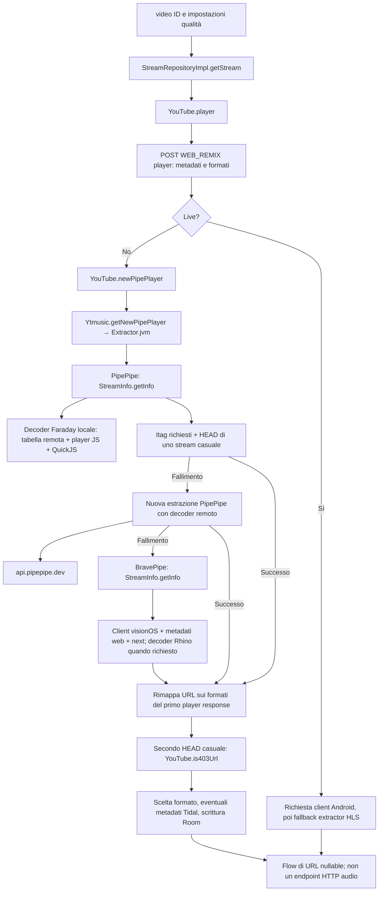

# M6 — SimpMusic: fattibilità dell'integrazione backend

Audit del **11 ottobre 2026**, branch locale `codex/m6-simpmusic-backend`.

## Decisione

**NO-GO per l'integrazione richiesta nelle condizioni attuali.** La portabilità
di alcune parti su JVM è plausibile e sostenuta da implementazioni `jvmMain`
reali. Non è però disponibile una sorgente YouTube con autorizzazione documentata
per il percorso di accesso diretto richiesto. Inoltre, il percorso risolutivo
analizzato impiega decodifica delle signature e dei parametri `n`, esecuzione del
player JavaScript, fallback a un servizio di decodifica e client alternativi:
funzioni incompatibili con i vincoli di questo laboratorio. [C-extractor],
[C-faraday], [C-engine], [P-decoder], [B-stream].

La fase A è stata completata. **Le fasi B e C sono state fermate al controllo
delle condizioni essenziali**, come richiesto: nessun servizio JVM, endpoint
`GET /api/audio/`, estrattore sostitutivo, proxy o integrazione nel player è stato
creato. La fase D non ha campioni SimpMusic; la fase E è questa decisione.
Il risultato non significa che un server JVM sia impossibile: significa che non
abbiamo dimostrato un servizio utile, autorizzato e conforme a questo incarico.

Sono stati aggiunti soltanto questo report e un laboratorio di **verifica offline
della riproducibilità dell'audit**, descritto in
[experiments/simpmusic-audit](../experiments/simpmusic-audit/README.md).
Il laboratorio non esegue gli estrattori e non simula una riproduzione riuscita.

## Identità del codice e metodo

| Repository         | Commit effettivamente letto                | Versione / osservazione                                                                                 |
| ------------------ | ------------------------------------------ | ------------------------------------------------------------------------------------------------------- |
| SimpMusic          | `0e08a12633a50f0758e820a35050ac4e9e066c8f` | Branch remoto predefinito `dev`; ultimo commit 10 ottobre 2026, 19:24:04 UTC                            |
| `SimpMusic/core`   | `b9f4ceac52e7c25cb059ea78141784dc164e0161` | **Gitlink del superproject e HEAD del submodule coincidono**; non usata una versione arbitraria di core |
| PipePipeExtractor  | `f8982ca9e7757b196139d746b3069c74b79ded1a` | Pin Gradle `f8982ca9e7`, checkout esterno corrispondente                                                |
| BravePipeExtractor | `0fcaf19ecc56fe875ddceaee381217a59514f3cf` | Pin Gradle `0fcaf19ecc`, checkout esterno corrispondente                                                |
| quickjs-kt         | `a081755bcdb18ee6afa7ffee25b8fa976f06d31f` | Tag `v1.0.15`, uguale alla versione dichiarata da SimpMusic                                             |

Clone ricorsivo eseguito realmente:

```powershell
git clone --recurse-submodules --shallow-submodules https://github.com/maxrave-dev/SimpMusic.git ../musicbit-audits/SimpMusic
git -C ../musicbit-audits/SimpMusic rev-parse HEAD
git -C ../musicbit-audits/SimpMusic ls-tree HEAD core
git -C ../musicbit-audits/SimpMusic submodule status --recursive
```

Directory esterne, sorelle di MusicBit: `musicbit-audits/SimpMusic`,
`SimpMusic-PipePipeExtractor`, `SimpMusic-BravePipeExtractor`,
`SimpMusic-quickjs-kt`. Quest'ultimo clone serve solo a leggere il binding nativo:
i suoi submodule QuickJS/C-vector non sono stati inizializzati né compilati.
Gitlink letti: QuickJS `04be246001599f5995fa2f2d8c91a0f198d3f34c`, C-vector
`774773d4cb1e66dd736e90e7f482d4f22af464c6`. [Q-modules].

SimpMusic e core non risultavano archiviati; avevano commit del 10 ottobre 2026.
PipePipe e BravePipe analizzati hanno commit del 24 agosto 2026. Questi sono
indicatori di attività, non una garanzia di affidabilità o compatibilità con
YouTube. Lo snapshot dell'audit conserva data e SHA. Fonti di manutenzione:
[SimpMusic API](https://api.github.com/repos/maxrave-dev/SimpMusic),
[core API](https://api.github.com/repos/maxrave-dev/core).

Classificazione delle evidenze:

- **CODICE**: implementazioni lette al commit fissato, link a file e righe sotto.
- **VERIFICA OFFLINE**: controllo di SHA, gitlink, hash dei file e riferimenti;
  non prova la semantica di rete né che i moduli compilino.
- **REGRESSIONE MUSICBIT**: test dell'applicazione esistente, con fixture originali.
- **NON MISURATO**: risoluzione SimpMusic, HTTP media YouTube, JVM in servizio,
  primo suono, iPhone fisico e CarPlay. Nessun risultato upstream viene assunto.

## Percorso reale: video ID → descrittore della sorgente



Il diagramma descrive il codice, **non operazioni eseguite contro YouTube**.
Il ramo Faraday può usare cache; i tentativi non vengono sempre tutti eseguiti.
Le sorgenti dei passaggi sono [C-stream], [C-youtube], [C-extractor],
[C-live], [P-fetch], [P-decoder], [B-stream], [B-js].

### Mappa dei moduli effettivamente analizzati

I percorsi `C:` qui significano repository **core**, non unità Windows;
`S:` superproject, `P:` PipePipeExtractor, `B:` BravePipeExtractor, `Q:` quickjs-kt.
Ogni link risolve al repository e SHA della tabella precedente.

| File / funzione                                                                      | Righe                              | Responsabilità e conseguenze                                                                                       |
| ------------------------------------------------------------------------------------ | ---------------------------------- | ------------------------------------------------------------------------------------------------------------------ |
| C: `data/.../repository/StreamRepositoryImpl.kt`, `getStream`                        | 86–306 [C-stream]                  | Legge qualità/language da DataStore, chiama il resolver, seleziona il formato, salva in Room, emette un URL o null |
| Stesso file, `updateFormat`, `invalidateFormat`                                      | 47–84, 393–402 [C-stream]          | Aggiorna scadenza/tracking; invalidazione anticipa la scadenza. `updateFormat` non sostituisce audioUrl/videoUrl   |
| C: `service/kotlinYtmusicScraper/.../YouTube.kt`, `player`                           | 1489–1615 [C-youtube]              | Prima risposta WEB_REMIX, ramo live, estrattori, classificazione Song/Video dalla forma della thumbnail            |
| Stesso file, `newPipePlayer`                                                         | 1320–1425 [C-youtube]              | Richiede stato OK per VOD, rimappa URL per itag, preferenza lingua, controlla un URL casuale con HEAD              |
| C: `.../Ytmusic.kt`, `player`, `getNewPipePlayer`                                    | 275–277, 466–504 [C-player]        | Adapter Ktor `/player` e invocazione sincrona del vero estrattore                                                  |
| C: `.../src/jvmMain/.../extractor/Extractor.jvm.kt`                                  | 21–175 [C-extractor]               | Tre tier; combina audio/video/video-only e perde i metadati di trasporto trasformandoli in coppie itag/URL         |
| C: `.../src/jvmMain/.../extractor/FaradayJsDecoder.kt`                               | 28–99 [C-faraday]                  | Adapter PipePipe→Faraday; thread dedicato, `runBlocking`, invalidazione                                            |
| C: `.../cipher/FaradayCipherEngine.kt`                                               | 47–115, 138–267 [C-engine]         | Cache hash/solver, download tabella e player script, decodifica locale                                             |
| C: `.../cipher/RemotePlayerConfigStore.kt`                                           | 23–77, 174–225, 400–421 [C-config] | TTL, ETag, limiti di risposta, refresh serializzato, restrizioni della sorgente della tabella                      |
| C: `.../cipher/QuickJsEngine.kt`                                                     | 15–101, 242–263 [C-quickjs]        | Runtime JS nativo, limiti di memoria/stack/valutazione e rilascio                                                  |
| C: `.../extractor/BraveNewPipeUtils.kt`, `hasRequiredItags`, `headCheckRandomStream` | 14–45 [C-brave-utils]              | Richiede almeno un itag audio **e video**, HEAD casuale; non verifica lo specifico audio selezionato               |
| C: `.../extractor/NewPipeUtils.kt`, downloader                                       | 21–114 [C-pipe-utils]              | OkHttp sincrono/asincrono, mapping 429, body interamente letto per le risposte di estrazione                       |
| C: `.../extractor/AudioTrackOrder.kt`                                                | 17–53 [C-order]                    | Ordinamento lingua/originale e lettura clen: utility pure Kotlin, senza I/O                                        |
| C: `domain/.../entities/NewFormatEntity.kt`                                          | 9–35 [C-format]                    | URL e tracking persistiti, MIME, codec, bitrate, durata, scadenza; non è un contratto di autorizzazione            |
| P: `.../stream/StreamInfo.java`, `getInfo`                                           | 91–150 [P-info]                    | Fetch, stream e metadati opzionali; possibile SponsorBlock con attesa aggiuntiva                                   |
| P: `.../YoutubeStreamExtractor.java`, `onFetchPage`                                  | 2190–2369 [P-fetch]                | Richieste concorrenti web/player/next, sorgenti condizionali, attesa dei risultati necessari                       |
| P: `.../YoutubeApiDecoder.java`, `decodeBatch`                                       | 183–307 [P-decoder]                | Decoder locale o servizio remoto, cache delle trasformazioni                                                       |
| B: `.../YoutubeStreamExtractor.java`, `onFetchPage`                                  | 806–825 [B-stream]                 | Richieste seriali visionOS → metadati web → next                                                                   |
| B: `.../utils/JavaScript.java`, `run`                                                | 21–31 [B-js]                       | Esecuzione Rhino del codice JS fornito dal resolver                                                                |
| Q: `.../NativeLibraryLoader.jvm.kt`, `loadLibrary`                                   | 22–110 [Q-loader]                  | Binding JNI: sistema, percorso configurato o estrazione della libreria dal JAR                                     |

### Cosa restituisce davvero StreamRepositoryImpl

`getStream` restituisce **`Flow<String?>`**, non una sorgente normalizzata con
stato tipizzato, autorizzazione, MIME e scadenza nello stesso valore. Questi ultimi
metadati tecnici sono invece salvati in `NewFormatEntity`. Un fallimento può
diventare `null`, perdendo una distinzione esplicita fra 403, 429, formato assente
e cancellazione. La mappatura proposta per un eventuale adapter deve mantenere
separati esito, MIME/codec, delivery e validità; MusicBit già li separa nel
[contratto PlaybackProvider](../packages/shared/src/playback.ts). [C-stream],
[C-format], [C-response].

La cache Room non è consultata direttamente da `getStream`: questo chiama sempre
`YouTube.player`. Sono i consumer Media3/mpv a decidere se usare il formato
persistito. In Media3 viene verificata prima `expiredTime`; nel ramo mpv
`extractPlayableUrl` letto viene invece fatto HEAD senza un confronto esplicito
con `expiredTime`. Aggiungere un servizio non trasferirebbe automaticamente la
politica del consumer. [C-stream], [C-media3], [C-mpv-resolve].

Anche l'accesso ai formati non è già pronto per un processo headless:
`getNewFormat` applica `flowOn(Dispatchers.Main)`. Una JVM server deve fornire
un dispatcher Main oppure separare quella dipendenza; la sua presenza in
un'app desktop non prova il funzionamento in un servizio minimale. [C-stream].

`updateFormat` rinnova scadenza e tracking usando una nuova risposta, senza
sostituire gli URL preesistenti: la scadenza di una risposta non può essere
assunta come nuova validità di un URL vecchio. È un rischio derivabile dal codice,
non un errore riprodotto sul servizio. [C-stream].

La scelta standard privilegia Opus 250/251/774, con AAC 141 come famiglia High.
Non impone AAC-LC in MP4 per Safari. Se un itag High e il suo gemello mancano,
il ramo `if (audioTwinItag != null)` può restituire null e si arriva al fallback
generico `lastOrNull`, che non filtra solo audio. `hasRequiredItags` non include
AAC 140 fra gli itag richiesti: una sorgente utile audio-only può essere scartata
prima della selezione. Questi sono limiti della selezione rispetto a un backend
audio per iOS, non prove di fallimento universale. [C-itags], [C-stream],
[C-brave-utils].

## PipePipe, Faraday e BravePipe nella versione fissata

### PipePipe

Il core usa il fork **maxrave-dev/PipePipeExtractor**, non un generico NewPipe
aggiornato all'ultima versione. `Extractor.init` registra globalmente downloader
e decoder. Il tier 1 usa Faraday; in caso di itag mancanti o HEAD non riuscito
si riesegue l'estrazione con decoder locale rimosso, poi si passa a BravePipe.
Ci sono inoltre fallback interni alla libreria: i tre tier dell'adapter non sono
tre singole richieste HTTP. [S-versions], [C-extractor], [P-decoder].

Il client predefinito del fork è `visionos`. `onFetchPage` schedula più richieste
e attende web player, JSON player e next, con sorgenti supplementari condizionali;
next rimane necessario anche quando servirebbe solo l'URL audio. I PoToken hook
esistono nella libreria, ma **non è stato osservato un provider PoToken registrato
da questo percorso JVM del core**. La sola presenza delle API non dimostra che
siano attive. [P-default], [P-fetch], [C-extractor].

`StreamInfo` può rappresentare delivery SABR. Il fork marca gli stream con
`DeliveryMethod.SABR` e usa come `content` il serverAbrStreamingUrl: non significa
che quel valore sia un file audio progressive riproducibile da Safari.
L'adapter del core conserva solo itag/content, quindi un adapter server dovrebbe
conservare e validare la delivery originale, rifiutando quelle non supportate.
Nessun supporto SABR è stato implementato o provato. [P-sabr], [C-extractor].

### Faraday

È un'implementazione inclusa nel core, non un servizio Android indispensabile.
Legge una tabella da `simpmusic-files`, identifica il player da `iframe_api`,
scarica `base.js` e lo esegue in QuickJS per le trasformazioni signature/`n`.
Leggere `iframe_api` qui **non significa riprodurre con un iframe**. Il servizio
remoto PipePipe resta una dipendenza alternativa alla decodifica locale.
Questo percorso è stato letto, non eseguito. [C-engine], [C-faraday], [P-decoder].

Cache effettive: hash del player 30 minuti; solver corrente per hash/epoch;
tabella 6 ore, ETag, ritentativo dopo errore 60 secondi e cooldown di refresh
5 minuti. Il motore usa un mutex intorno agli ingressi pubblici. Queste cache
risparmiano discovery/JS, **non eliminano `/player`, estrazione per ID o HEAD**.
Il decoder remoto ha una `HashMap` di trasformazioni senza TTL/cap nel codice
letto; non è una cache autorizzata di sorgenti audio. [C-engine], [C-config],
[P-decoder].

Il wrapper JVM dedica un thread con stack richiesto di **32 MiB**; QuickJS
configura limite nativo **192 MiB**, stack nativo **8 MiB** e valutazione
**10 secondi**. Sono limiti/configurazioni, non consumo RSS/CPU misurato né
memoria necessariamente allocata per intero. Il commento upstream riferisce
crash nativi da ricorsione; non sono stati riprodotti. [C-faraday], [C-quickjs].

### BravePipe

Il tier 3 usa il fork **maxrave-dev/BravePipeExtractor** con namespace
`org.schabi.newpipe`. In quella versione `onFetchPage` esegue client visionOS,
metadati web e next in sequenza. Ha dipendenze Rhino e funzioni di estrazione/
trasformazione JavaScript, anche se non tutte sono necessariamente esercitate
su ogni video. Non è un motore che garantisce un URL AAC privo di trasformazioni
o restrizioni. [B-stream], [B-build], [B-js], [B-js-manager].

L'adapter JVM restituisce lista vuota al fallimento; non applica allo stesso modo
il controllo itag/HEAD del ramo PipePipe prima del ritorno. Il livello
`YouTube.newPipePlayer` applica poi un ulteriore HEAD casuale. Una verifica di
URL casuale non prova che lo stream scelto, il suo seek o tutta la durata siano
utilizzabili. [C-extractor], [C-brave-utils], [C-youtube].

## Portabilità JVM Linux e dipendenze

**Accertato staticamente:** esistono target JVM e implementazioni senza import
Android per estrazione e HTTP. **Non accertato:** compilazione ed esecuzione
autonoma di questa combinazione su Debian. La build completa non è stata
eseguita: il gate delle autorizzazioni è fallito prima del prototipo.
L'ambiente disponibile ha Windows/JDK 17; WSL Ubuntu x86_64 non ha `java`,
`javac` o `kotlinc` nel PATH; Docker Linux non è in esecuzione. Non sono stati
installati toolchain inutili dopo l'arresto. [C-scraper-build], [C-ktor-build].

| Componente                             | Senza Android / Compose / Media3 / libmpv? | Valutazione sul sorgente                                                                                                                 |
| -------------------------------------- | ------------------------------------------ | ---------------------------------------------------------------------------------------------------------------------------------------- |
| `AudioTrackOrder`, `contentLengthOf`   | Sì                                         | Kotlin + Regex/collections; riutilizzo possibile, non risolvono una sorgente [C-order]                                                   |
| `PlayerResponse` e modelli             | Sì rispetto ai player                      | Richiedono serialization e altri modelli del modulo; isolabili con dipendenze esplicite [C-response]                                     |
| Downloader JVM PipePipe/Brave          | Sì                                         | OkHttp + librerie Java, senza Android; cancellazione/timeout server da progettare [C-pipe-utils], [C-brave-utils]                        |
| PipePipe e BravePipe                   | Sì a livello di sorgenti Java              | Toolchain Java 17 dichiarata; questo non valida la loro rete né gli artefatti risolti [P-build], [B-root]                                |
| Faraday + QuickJS                      | Sì rispetto ai player                      | Kotlin/Ktor/coroutines **con JNI nativo**; bloccato dai vincoli sulle trasformazioni [C-engine], [Q-loader]                              |
| `kotlinYtmusicScraper` come modulo     | Parzialmente                               | `jvm()` esiste, ma dipende da domain/common/ktorExt; Gradle include plugin Android e source set multipiattaforma [C-scraper-build]       |
| `StreamRepositoryImpl` dal modulo data | Non come JAR minimale già autonomo         | LocalDataSource/Room, DataStore e domain; data/jvmMain dipende anche da media-jvm, JNA e integrazioni desktop [C-stream], [C-data-build] |
| `media-jvm` / mpv                      | No rispetto a libmpv                       | Riproduzione desktop nativa via JNA, non un backend di risoluzione necessario [C-media-build], [C-mpv-library]                           |
| `media3`, UI Compose, Android services | No                                         | Da escludere da un servizio JVM; non offrono vantaggi per HTMLAudioElement [S-settings], [C-media3]                                      |

### Inventario dichiarato della catena rilevante

| Livello                         | Dipendenze / versioni lette                                                                                                                                                                                                                                                          |
| ------------------------------- | ------------------------------------------------------------------------------------------------------------------------------------------------------------------------------------------------------------------------------------------------------------------------------------ |
| Build SimpMusic                 | Gradle **9.8.1** con checksum wrapper; Kotlin/serialization **2.4.20**, KSP **2.3.9**, AGP **9.4.1**; common/domain/data dichiarano toolchain **21** [S-wrapper], [S-versions], [C-common-build], [C-domain-build], [C-data-build]                                                   |
| Scraper commonMain              | stdlib/reflect, common/domain/ktorExt, Koin BOM **4.2.2**, Okio **3.18.2**, datetime **0.8.0**, Ktor **3.6.0** (encoding, logging, negotiation, JSON/XML/protobuf), JSON **1.11.0**, Ksoup **0.6.0**, quickjs-kt **1.0.15** [C-scraper-build], [S-versions]                          |
| HTTP JVM                        | OkHttp **5.5.0**, Ktor OkHttp/CIO, Brotli Java **0.1.2**; il motore `actual getEngine()` è OkHttp [C-ktor-build], [C-http-engine], [S-versions]                                                                                                                                      |
| common/domain/data              | Kermit **2.2.0** e file logging; URI **0.0.21**; Room **2.8.5**, paging **3.5.2**, DataStore **1.2.1**, SQLite bundled **2.7.1**; KSP per schema; servizi aggiuntivi e JNA **5.19.1** entrano importando tutto data [C-common-build], [C-domain-build], [C-data-build], [S-versions] |
| PipePipe transitivo dichiarato  | nanojson, timeago-parser, jsoup **1.22.2**, Java-WebSocket **1.6.0**, annotations, autolink **0.12.0**, protobuf-java **4.35.1**, OkHttp **5.4.0**, Brotli, commons-lang3 **3.20.0**, BouncyCastle **1.85**, `org.json` compileOnly [P-build], [P-root]                              |
| BravePipe transitivo dichiarato | nanojson, jsoup **1.23.1**, JSR305 **3.0.2**, protobuf-javalite **4.35.1**, Rhino/Rhino engine **1.8.1**, hlsdownloader **1.0.0**; generatori Protobuf/Wire in build [B-build], [B-versions]                                                                                         |
| JNI per Faraday                 | quickjs-kt → libquickjs: loader Linux x64/aarch64, `.so`, estrazione temporanea dal JAR o libreria configurata; sorgenti native C e toolchain CMake/Ninja/Zig per ricompilare il binding [Q-build], [Q-loader], [Q-native-build]                                                     |
| Solo player desktop / Android   | libmpv via JNA nel desktop; Media3 Android; ffmpeg-kit-audio **6.0.1** solo androidMain dello scraper, **non una dipendenza del suo resolver JVM** [C-media-build], [C-scraper-build]                                                                                                |

Questa è la catena **dichiarata e letta**, non una SBOM della risoluzione Gradle:
non abbiamo generato un classpath efficace o verificato la disponibilità di
tutti gli artefatti. Le dipendenze vincolate possono cambiare il grafo finale.
In particolare, il root forza nanojson
`c7a6c1c08d16b6d5ecded34758e6415e07be2166`; lo scraper esclude protobuf-java
per evitare conflitti con javalite. `org.json:json:20231013` è aggiunto dal
**desktopApp**, non dal solo scraper JVM: importare quest'ultimo da solo può
richiedere di aggiungerlo esplicitamente. [S-build], [C-scraper-build],
[S-desktop], [S-versions].

Repository di build dichiarati: Maven Central, Google, Gradle Plugin Portal,
JitPack, JogAmp e repository Maven su GitHub BravePipe. Non sono servizi runtime
obbligatori tutti insieme; comportano comunque disponibilità e supply chain da
verificare prima di produrre un container ripetibile. [S-settings].

### Dipendenze di rete runtime

| Destinazione                                                | Ruolo nel percorso letto                                                                                                                                                               |
| ----------------------------------------------------------- | -------------------------------------------------------------------------------------------------------------------------------------------------------------------------------------- |
| `music.youtube.com`, `www.youtube.com`                      | InnerTube, watch/next/player, discovery e player JS [C-player], [C-engine], [P-fetch], [B-stream]                                                                                      |
| Host media restituiti / manifest                            | HEAD e successiva lettura dal consumer; devono essere classificati e autorizzati, non assunti affidabili dal solo estrattore [C-brave-utils], [C-youtube]                              |
| `raw.githubusercontent.com/maxrave-dev/simpmusic-files/...` | Tabella player dinamica Faraday; può influenzare il resolver senza aggiornare MusicBit [C-engine]                                                                                      |
| `api.pipepipe.dev`                                          | Decoder e latest-player quando si passa al tier remoto [P-decoder], [P-metadata]                                                                                                       |
| Release GitHub Metrolist/Faraday                            | Fallback del timestamp per tabella legacy [C-config]                                                                                                                                   |
| Tidal OAuth/search                                          | Lookup BPM/key opzionale **prima dell'emissione** dell'URL nel repository per Song; credenziali da configurazione remota, non necessario alla riproduzione audio [C-stream], [C-tidal] |
| SponsorBlock / ReturnYouTubeDislike                         | Richieste condizionali nell'estrattore; non requisito audio fondamentale [P-info], [P-fetch]                                                                                           |

`YouTube.pipeStream`/Piped e metodi PoToken esistono nel modulo ma non sono
chiamati dal percorso VOD `player → newPipePlayer` analizzato. Non sono stati
presentati come fallback attivi né impiegati per una prova. [C-other], [C-player].

## Prestazioni, concorrenza e rischi tecnici

| Punto osservato                                   | Impatto plausibile, non misurato                                                                                                                     | Riferimento                                             |
| ------------------------------------------------- | ---------------------------------------------------------------------------------------------------------------------------------------------------- | ------------------------------------------------------- |
| Primo WEB_REMIX player prima dell'estrattore      | Prima fase seriale, duplicazione di metadati/player rispetto al fork                                                                                 | [C-youtube], [P-fetch]                                  |
| Tre tier + fallback interni + retry consumer mpv  | Latenza e costo crescono sui fallimenti; nessun budget end-to-end dimostrato                                                                         | [C-extractor], [C-mpv-load]                             |
| PipePipe richiede next/metadati oltre agli stream | Audio aspetta lavoro non strettamente necessario                                                                                                     | [P-fetch], [P-info]                                     |
| HEAD casuale PipePipe + HEAD casuale nel wrapper  | Round trip aggiuntivi; uno stream video può determinare il fallimento dell'audio                                                                     | [C-brave-utils], [C-youtube]                            |
| Cache Room ancora soggetta a HEAD nel consumer    | Cache calda non equivale a zero rete                                                                                                                 | [C-mpv-resolve], [C-media3]                             |
| Lookup Tidal + scrittura Room prima di emit       | Operazioni potenzialmente bloccanti; non conversioni audio                                                                                           | [C-stream]                                              |
| Mutex Faraday                                     | Protegge il runtime, ma serializza decodifiche di ID differenti; non è deduplica di richieste per video ID                                           | [C-engine]                                              |
| Decoder globale mutato nei tier                   | Richieste concorrenti possono interferire sulla scelta locale/remota; rischio statico, non race riprodotta                                           | [C-extractor], [P-decoder]                              |
| `runBlocking`, `execute()` e catch ampi           | Il disconnect HTTP del futuro servizio non cancella automaticamente la chiamata sincrona; CancellationException può venire trasformata in fallimento | [C-faraday], [C-pipe-utils], [C-extractor], [C-youtube] |
| Scadenze dei formati e URL                        | Expiry di WEB_REMIX e URL prodotti da un'altra estrazione non sono necessariamente identici; serve minimo della validità effettiva                   | [C-youtube], [C-stream]                                 |
| URL con query `range=0-...`                       | Non implementa il protocollo HTTP Range di un server; non dimostra 206, seek o backpressure                                                          | [C-stream]                                              |

La valutazione QuickJS ha un limite di 10 s e la tabella remota timeout di 5 s.
Non vanno estesi a tutta la catena: `FaradayJsDecoder` crea un proprio HttpClient,
alcune richieste non impostano valori di deadline, i downloader OkHttp non
impostano `callTimeout` esplicito e il repository non impone un timeout totale.
Il codice restituisce coroutines/Flow ma non espone di per sé una politica di
abort subscriber per un servizio HTTP. [C-faraday], [C-engine], [C-config],
[C-safe-http], [C-pipe-utils], [C-stream].

### Buffering e cambio brano: perché non prova il comportamento PWA

Il desktop riproduce con **libmpv**. `triggerPrecachingInternal` risolve fino a
due tracce successive, crea altri player nativi e chiama `loadFile` in pausa
per scaldare il demuxer. Al cambio può promuovere quel player e avviarlo. È
precaricamento reale di dati, non solo cache di URL, e usa più player.
Non è trasferibile al requisito MusicBit di un unico HTMLAudioElement.
[C-mpv-precache], [C-mpv-load].

L'evento nativo `finished` controlla che il player sia quello corrente, passa
a `handleTrackEndInternal` e poi a repeat/seekToNext/crossfade. È una catena
desktop Kotlin/mpv: non verifica che un callback JavaScript della PWA venga
eseguito a schermo bloccato. Media3 Android, notifiche native e Android Auto
non dimostrano compatibilità Safari, Media Session web o CarPlay.
[C-mpv-end], [C-mpv-next], [C-media-build], [S-settings].

In MusicBit il server potrebbe al massimo risolvere/preparare un descrittore;
la PWA rimarrebbe responsabile di cambiare `src`, rispettare il gesto utente e
chiamare play. Un nuovo backend non elimina queste condizioni né dimostra
continuità o gapless. Il live HLS SimpMusic è il manifest di una trasmissione,
non un flusso HLS continuo che concatena la coda musicale. [C-live], [C-stream],
[PlayerEngine](../apps/web/src/player/engine.ts),
[registro fisico iOS](ios-test-report.md).

## Sicurezza, accesso e licenze

### Logging e SSRF

Il log riassuntivo recente di `StreamRepositoryImpl` evita l'URL, ma non l'intera
catena: `YouTube.newPipePlayer` stampa gli URL, il client installa `LogLevel.ALL`
e CurlLogger, e quest'ultimo ha `redactHeaders` vuoto per default. Sono inoltre
presenti log di cookie/auth e URL nel consumer mpv. Importare il modulo così
com'è non soddisfa il requisito M6 di assenza di URL temporanei/cookie/token
nei log. Non sono state usate credenziali né generate catture sensibili.
[C-stream], [C-youtube], [C-http], [C-curl], [C-mpv-resolve].

Il fetch della tabella Faraday restringe la sorgente e disabilita redirect; è
un accorgimento specifico, non un'allowlist SSRF per un proxy media. I client
generici accettano URL e seguono redirect; Ktor consente anche downgrade HTTPS
nel client letto. Non esiste nel percorso analizzato la validazione di host,
IP risolto, ogni redirect e connessione necessaria per l'endpoint M6.
Non è stato eseguito un penetration test. [C-config], [C-safe-http], [C-http],
[C-brave-utils].

`noLogIn` è un parametro della funzione `YouTube.player` ma non viene letto nel
corpo di quella versione. La richiesta normale usa `setLogin = true` e può
inviare il cookie configurato: il nome del parametro non certifica un percorso
anonimo. Nessuna autenticazione è stata tentata. [C-youtube], [C-player], [C-http].

### Permessi e licenze

SimpMusic/core e i due fork contengono **GPL v3**, non MIT. BravePipe include
anche header SPDX GPL-3.0-or-later; conservare le indicazioni dei singoli file.
quickjs-kt contiene Apache-2.0; i componenti nativi e transitivi mantengono
licenze proprie. Nessun sorgente upstream è stato copiato in MusicBit.
Un futuro riuso richiede attribuzioni, licenze e obblighi di distribuzione del
codice applicabili; separare i processi non autorizza l'accesso ai contenuti.
[S-license], [C-license], [P-license], [B-license], [B-build], [Q-license].

L'accessibilità pubblica di un video e la licenza del software non sono permessi
di estrazione/proxy del servizio. I
[termini YouTube](https://www.youtube.com/static?template=terms) distinguono
l'ascolto tramite funzioni del servizio dall'accesso automatizzato e dagli usi
non autorizzati. Le
[Developer Policies](https://developers.google.com/youtube/terms/developer-policies)
prevedono inoltre restrizioni su API non documentate, separazione audio/video,
download/cache e background player. Non viene attribuito automaticamente a ogni
scraper lo status di client API ufficiale: sono comunque limiti da verificare,
non un'autorizzazione ottenuta installando SimpMusic.

In questa sessione non è stato fornito un record per un ID YouTube con permesso
sul contenuto **e sul percorso di accesso al servizio**. Non esistono il file
standard `artifacts/youtube-playback-permissions.json`, una configurazione
`YOUTUBE_PLAYBACK_PERMISSIONS_FILE` nel processo o un `.env` root. Lo storico
M5 registra lo stesso blocco. Non sono stati interrogati `/player`, decoder
remoti o host media YouTube dal laboratorio M6.
[Permessi M5](../apps/api/src/youtube-playback/permissions.ts),
[evidenza M5](youtube-playback-feasibility.md).

I toni originali e le demo autorizzate consentono test del trasporto e di MusicBit,
ma **non passano attraverso il resolver YouTube di SimpMusic**. Sostituire il
resolver con un URL fisso, un mock o yt-dlp non risponderebbe alla domanda M6.
Per questo non è stato costruito un servizio dimostrativo che mascheri il blocco.

## Fasi B e C: gate e contratto necessario prima di ripartire

| Condizione essenziale                                          | Esito                                                                     |
| -------------------------------------------------------------- | ------------------------------------------------------------------------- |
| Parte core tecnicamente separabile dai player                  | Parziale, accertato dal sorgente; build Linux indipendente non verificata |
| Percorso risolutivo riutilizzabile senza le operazioni escluse | Non dimostrato nel percorso analizzato                                    |
| Sorgente di prova e accesso diretto autorizzati                | Mancanti                                                                  |
| Servizio JVM originale funzionante                             | Non realizzato dopo il gate                                               |
| Endpoint audio interno e controllo accessi                     | Non realizzato; nessuna route pubblica o privata registrata               |

Un futuro esperimento dovrebbe esporre identità autorizzate, non accettare URL
arbitrari; restituire MIME/codec/delivery, validUntil e errori tipizzati verso
PlaybackProvider; mantenere solo descrittori in memoria, scadenza anticipata,
deduplica per identità, limiti di concorrenza e cancellazione per subscriber.
L'URL remoto rimarrebbe interno e accessibile solo a richieste autenticate del
laboratorio. Questo è un contratto proposto, **non un'API implementata**.

La fase C richiederebbe una verifica autonoma del trasporto: lo scraper non la
fornisce. Criteri da soddisfare prima di abilitare una route:

| Requisito HTTP         | Comportamento da validare, oggi NON IMPLEMENTATO                                                                                                                           |
| ---------------------- | -------------------------------------------------------------------------------------------------------------------------------------------------------------------------- |
| GET progressivo        | Inoltro a stream con backpressure, senza `readBytes`/buffer completo né file temporaneo audio                                                                              |
| HEAD                   | Nessun body downstream; Content-Type/Length coerenti con GET; upstream HEAD o fallback esplicito e cancellato, senza scaricare il file                                     |
| Range valido           | Inoltro del range; 206 solo se origine conferma quel range con Content-Range valido e lunghezza coerente                                                                   |
| Origine ignora Range   | Preservare 200 e metadati della risposta completa; non inventare un 206                                                                                                    |
| Range insoddisfacibile | 416 con `Content-Range: bytes */N` quando la dimensione è nota; distinguere un errore sintattico da uno upstream                                                           |
| Seek                   | Range chiusi, aperti, suffix e casi limite; politica esplicita per multi-range; verifica effettiva del decoder browser                                                     |
| Abort/deadline         | Disconnect interrompe upstream e rilascia socket/job; deadline connect/header/idle/total esplicite                                                                         |
| SSRF                   | Host esatti autorizzati, HTTPS, porte e IP pubblici ammessi; verifica DNS/IPv4/IPv6 e DNS rebinding, pin dell'indirizzo con TLS host corretto, controllo per ogni redirect |
| Accesso e log          | Bind loopback/rete privata, autenticazione interna, niente URL/query/cookie/token nei log o errori; revoca permessi e expiry prima di ogni lettura                         |
| Safari                 | AAC-LC in MP4/M4A verificato sullo stream reale; MIME/canPlayType non provano riproduzione completa o background                                                           |

Non è stato eseguito alcun test HTTP 200/206/416 di un endpoint SimpMusic M6,
perché non esiste quell'endpoint. I test di trasporto già presenti nei laboratori
M4/M5 non vengono riclassificati come validazione SimpMusic.

## Fase D: misure disponibili e mancanti

| Metrica SimpMusic M6                       |           n | Mediana | p95  | Esito                                      |
| ------------------------------------------ | ----------: | ------- | ---- | ------------------------------------------ |
| Discovery / risoluzione cold e warm        |           0 | n.d.    | n.d. | Gate bloccato                              |
| Primo byte audio upstream / downstream     |           0 | n.d.    | n.d. | Nessun servizio media avviato              |
| canplay / playing / click totale           |           0 | n.d.    | n.d. | Nessuna riproduzione SimpMusic nel browser |
| Successi / errori del resolver             | 0 tentativi | n.d.    | n.d. | Percentuali non definite, non 0% o 100%    |
| Cambio brano / richieste concorrenti       |           0 | n.d.    | n.d. | Nessun benchmark SimpMusic                 |
| RSS / CPU del servizio JVM                 |           0 | n.d.    | n.d. | Limiti QuickJS non usati come misure       |
| Riproduzione completa, seek, pausa/ripresa |           0 | n.d.    | n.d. | Non eseguiti su sorgente SimpMusic         |
| Safari iPhone / background / CarPlay       |           0 | n.d.    | n.d. | Nessuna nuova prova fisica                 |

Non si può quindi affermare un guadagno rispetto al player attuale. Lo storico
[MusicBit M2](performance.md) ha tre campioni desktop per scenario: non preparato
234,9 ms di mediana, preparato 15,3 ms, con preparazione esclusa dal click di
207,5–275,2 ms. Con nearest-rank e n=3 il p95 coincide con il massimo
(331,6 e 15,5 ms): sono statistiche di pochi campioni, non uno SLA.
Lo storico [M5](youtube-playback-feasibility.md) misura cinque ricerche catalogo
(cold p50/p95 508,2/593,5 ms; warm 1,61/2,11 ms) e **nessuno stream nativo
YouTube autorizzato**. Questi numeri non sono confronti prestazionali SimpMusic.

Per un confronto futuro servirebbero stessa sorgente autorizzata, rete, browser,
volume e dispositivo; timestamp distinti discovery/preparazione/GET/byte/
canplay/playing, costo del preload sempre incluso nel registro. Cold e warm
devono dichiarare quali cache vengono svuotate. Almeno 30 campioni per scenario,
mediana e p95 nearest-rank, inclusione separata dei fallimenti e risorse JVM
campionate durante la prova; concorrenza e cambio brano con scadenza controllata.
È un protocollo da eseguire solo dopo i gate, non una misura effettuata.

`playing` indica uno stato browser; non dimostra l'istante del suono fisico.
I test manuali dovrebbero coprire Safari e PWA, brani completi, seek iniziale/
centrale/finale, pausa/ripresa, passaggio cold/warm e due cambi a schermo bloccato.
Registrare modello/iOS, rete, durata, log e interruzioni nel registro iOS.
Le politiche WebKit sul gesto utente sono un ulteriore motivo per preservare
il player: la [nota WebKit](https://webkit.org/blog/6784/new-video-policies-for-ios/)
è storica e non sostituisce prove sulla versione iOS corrente.

## Controlli realmente eseguiti e preservazione M1–M5

- `pnpm check`: **superato**, lint, typecheck, **141 test Vitest**, build di PWA,
  API e laboratori M4/M5.
- `pnpm test:e2e` con configurazione originale: **bloccato prima dei test**,
  `EACCES` sulla porta 4174. Windows esclude le porte 4096–4795, comprendendo
  anche 4182 e 4184; nessuna modifica a firewall o riserve di sistema.
- Ripetizione con copie esterne dei quattro spec e dei tre server fixture,
  cambiando solo import per la collocazione esterna e porte
  4174→15474, 4182→15482, 4184→15484: **40 E2E superati**, Chromium e WebKit
  desktop con profilo mobile. Build sotto test identica. Il primo caricamento
  della configurazione temporanea richiedeva `type: module`, poi corretto nella
  sola directory esterna.
- **7 verifiche offline M6 superate**: identità e gitlink, pin di dipendenze, hash normalizzati
  dei file letti, licenze, integrità dei riferimenti a file/righe, checkout puliti.
  Lo snapshot contiene **53 file di evidenza e 62 riferimenti al codice**.
  Ripetibili con `node --test experiments/simpmusic-audit/audit.test.mjs`.
- SHA-256 confrontati con il baseline dei file esistenti prima del lavoro:
  **150 file esistenti invariati**, solo quattro nuovi file M6; nessuna modifica
  a M1–M5. Branch locale M6; nessun commit, push o PR creato.

Risultati grezzi E2E esterni in
`../musicbit-audits/m6-e2e/results.json`; snapshot delle sorgenti nel laboratorio.
Le prove E2E usano i toni originali dei test esistenti, non SimpMusic/YouTube.
Le verifiche offline non sono integrate nella CI: richiedono i clone esterni
fissati. Nessun nuovo test iPhone o CarPlay viene dichiarato superato.

## Conclusione e alternative

**NO-GO oggi.** Aggiungere una JVM non risolve la mancanza di un percorso di
accesso autorizzato e non porta un beneficio misurato. Il resolver esiste su
JVM, ma trasferirlo interamente importa database, impostazioni, logging,
dipendenze native e fallback non ammessi. Il vantaggio di precache del desktop
dipende da più istanze mpv e non è compatibile con il player web da preservare.
[C-data-build], [C-extractor], [C-mpv-precache], [C-curl].

Restano riutilizzabili come idee separazione metadati/trasporto, ordinamento
multilingua, invalidazione esplicita e osservabilità degli stadi. MusicBit
possiede già cache TTL, deduplica/cancellazione e PlaybackProvider; non è stato
dimostrato che riscriverli in Kotlin migliori latenza o stabilità.
[C-order], [C-stream], [resolver MusicBit](../apps/api/src/playback/resolver.ts),
[cache MusicBit](../apps/api/src/catalog/cache.ts).

Per riprendere M6 occorrono permessi documentati sul preciso contenuto e accesso
al servizio, un percorso che non usi le operazioni escluse e una build JVM
minimale verificata. In loro assenza si può mantenere catalogo YouTube Music e
controllo ufficiale visibile già isolato in M5; ciò non soddisfa la riproduzione
nativa/background desiderata. Le demo autorizzate restano il controllo del
player, senza presentarle come sostituto del catalogo o successo SimpMusic.

## Riferimenti al codice fissato

Le definizioni dei link sottostanti sono verificate offline contro i clone e
gli hash registrati nello snapshot; nessun link al codice usa un branch mobile.

[S-settings]: https://github.com/maxrave-dev/SimpMusic/blob/0e08a12633a50f0758e820a35050ac4e9e066c8f/settings.gradle.kts#L1-L89
[S-build]: https://github.com/maxrave-dev/SimpMusic/blob/0e08a12633a50f0758e820a35050ac4e9e066c8f/build.gradle.kts#L1-L56
[S-versions]: https://github.com/maxrave-dev/SimpMusic/blob/0e08a12633a50f0758e820a35050ac4e9e066c8f/gradle/libs.versions.toml#L1-L231
[S-wrapper]: https://github.com/maxrave-dev/SimpMusic/blob/0e08a12633a50f0758e820a35050ac4e9e066c8f/gradle/wrapper/gradle-wrapper.properties#L1-L6
[S-desktop]: https://github.com/maxrave-dev/SimpMusic/blob/0e08a12633a50f0758e820a35050ac4e9e066c8f/desktopApp/build.gradle.kts#L75-L96
[S-license]: https://github.com/maxrave-dev/SimpMusic/blob/0e08a12633a50f0758e820a35050ac4e9e066c8f/LICENSE#L1-L18
[C-license]: https://github.com/maxrave-dev/core/blob/b9f4ceac52e7c25cb059ea78141784dc164e0161/LICENSE#L1-L18
[C-stream]: https://github.com/maxrave-dev/core/blob/b9f4ceac52e7c25cb059ea78141784dc164e0161/data/src/commonMain/kotlin/com/maxrave/data/repository/StreamRepositoryImpl.kt#L1-L403
[C-youtube]: https://github.com/maxrave-dev/core/blob/b9f4ceac52e7c25cb059ea78141784dc164e0161/service/kotlinYtmusicScraper/src/commonMain/kotlin/com/maxrave/kotlinytmusicscraper/YouTube.kt#L1320-L1615
[C-live]: https://github.com/maxrave-dev/core/blob/b9f4ceac52e7c25cb059ea78141784dc164e0161/service/kotlinYtmusicScraper/src/commonMain/kotlin/com/maxrave/kotlinytmusicscraper/YouTube.kt#L1434-L1485
[C-other]: https://github.com/maxrave-dev/core/blob/b9f4ceac52e7c25cb059ea78141784dc164e0161/service/kotlinYtmusicScraper/src/commonMain/kotlin/com/maxrave/kotlinytmusicscraper/YouTube.kt#L1950-L1955
[C-http]: https://github.com/maxrave-dev/core/blob/b9f4ceac52e7c25cb059ea78141784dc164e0161/service/kotlinYtmusicScraper/src/commonMain/kotlin/com/maxrave/kotlinytmusicscraper/Ytmusic.kt#L98-L275
[C-player]: https://github.com/maxrave-dev/core/blob/b9f4ceac52e7c25cb059ea78141784dc164e0161/service/kotlinYtmusicScraper/src/commonMain/kotlin/com/maxrave/kotlinytmusicscraper/Ytmusic.kt#L275-L504
[C-tidal]: https://github.com/maxrave-dev/core/blob/b9f4ceac52e7c25cb059ea78141784dc164e0161/service/kotlinYtmusicScraper/src/commonMain/kotlin/com/maxrave/kotlinytmusicscraper/Ytmusic.kt#L1304-L1340
[C-extractor]: https://github.com/maxrave-dev/core/blob/b9f4ceac52e7c25cb059ea78141784dc164e0161/service/kotlinYtmusicScraper/src/jvmMain/kotlin/com/maxrave/kotlinytmusicscraper/extractor/Extractor.jvm.kt#L1-L166
[C-faraday]: https://github.com/maxrave-dev/core/blob/b9f4ceac52e7c25cb059ea78141784dc164e0161/service/kotlinYtmusicScraper/src/jvmMain/kotlin/com/maxrave/kotlinytmusicscraper/extractor/FaradayJsDecoder.kt#L1-L111
[C-engine]: https://github.com/maxrave-dev/core/blob/b9f4ceac52e7c25cb059ea78141784dc164e0161/service/kotlinYtmusicScraper/src/commonMain/kotlin/com/maxrave/kotlinytmusicscraper/cipher/FaradayCipherEngine.kt#L1-L288
[C-config]: https://github.com/maxrave-dev/core/blob/b9f4ceac52e7c25cb059ea78141784dc164e0161/service/kotlinYtmusicScraper/src/commonMain/kotlin/com/maxrave/kotlinytmusicscraper/cipher/RemotePlayerConfigStore.kt#L1-L424
[C-quickjs]: https://github.com/maxrave-dev/core/blob/b9f4ceac52e7c25cb059ea78141784dc164e0161/service/kotlinYtmusicScraper/src/commonMain/kotlin/com/maxrave/kotlinytmusicscraper/cipher/QuickJsEngine.kt#L1-L262
[C-safe-http]: https://github.com/maxrave-dev/core/blob/b9f4ceac52e7c25cb059ea78141784dc164e0161/service/kotlinYtmusicScraper/src/commonMain/kotlin/com/maxrave/kotlinytmusicscraper/cipher/RestrictedHttpFetch.kt#L1-L42
[C-pipe-utils]: https://github.com/maxrave-dev/core/blob/b9f4ceac52e7c25cb059ea78141784dc164e0161/service/kotlinYtmusicScraper/src/jvmMain/kotlin/com/maxrave/kotlinytmusicscraper/extractor/NewPipeUtils.kt#L1-L163
[C-brave-utils]: https://github.com/maxrave-dev/core/blob/b9f4ceac52e7c25cb059ea78141784dc164e0161/service/kotlinYtmusicScraper/src/jvmMain/kotlin/com/maxrave/kotlinytmusicscraper/extractor/BraveNewPipeUtils.kt#L1-L96
[C-order]: https://github.com/maxrave-dev/core/blob/b9f4ceac52e7c25cb059ea78141784dc164e0161/service/kotlinYtmusicScraper/src/commonMain/kotlin/com/maxrave/kotlinytmusicscraper/extractor/AudioTrackOrder.kt#L1-L51
[C-format]: https://github.com/maxrave-dev/core/blob/b9f4ceac52e7c25cb059ea78141784dc164e0161/domain/src/commonMain/kotlin/com/maxrave/domain/data/entities/NewFormatEntity.kt#L1-L35
[C-response]: https://github.com/maxrave-dev/core/blob/b9f4ceac52e7c25cb059ea78141784dc164e0161/service/kotlinYtmusicScraper/src/commonMain/kotlin/com/maxrave/kotlinytmusicscraper/models/response/PlayerResponse.kt#L1-L120
[C-curl]: https://github.com/maxrave-dev/core/blob/b9f4ceac52e7c25cb059ea78141784dc164e0161/service/ktorExt/src/commonMain/kotlin/com/maxrave/ktorext/curl/CurlLoggerPlugin.kt#L1-L137
[C-scraper-build]: https://github.com/maxrave-dev/core/blob/b9f4ceac52e7c25cb059ea78141784dc164e0161/service/kotlinYtmusicScraper/build.gradle.kts#L1-L136
[C-common-build]: https://github.com/maxrave-dev/core/blob/b9f4ceac52e7c25cb059ea78141784dc164e0161/common/build.gradle.kts#L1-L95
[C-domain-build]: https://github.com/maxrave-dev/core/blob/b9f4ceac52e7c25cb059ea78141784dc164e0161/domain/build.gradle.kts#L1-L81
[C-data-build]: https://github.com/maxrave-dev/core/blob/b9f4ceac52e7c25cb059ea78141784dc164e0161/data/build.gradle.kts#L1-L158
[C-ktor-build]: https://github.com/maxrave-dev/core/blob/b9f4ceac52e7c25cb059ea78141784dc164e0161/service/ktorExt/build.gradle.kts#L1-L99
[C-http-engine]: https://github.com/maxrave-dev/core/blob/b9f4ceac52e7c25cb059ea78141784dc164e0161/service/ktorExt/src/jvmMain/kotlin/com/maxrave/ktorext/Engine.jvm.kt#L1-L7
[C-media-build]: https://github.com/maxrave-dev/core/blob/b9f4ceac52e7c25cb059ea78141784dc164e0161/media/media-jvm/build.gradle.kts#L1-L28
[C-mpv-library]: https://github.com/maxrave-dev/core/blob/b9f4ceac52e7c25cb059ea78141784dc164e0161/media/media-jvm/src/main/java/com/simpmusic/media_jvm/mpv/MpvLibrary.kt#L1-L40
[C-itags]: https://github.com/maxrave-dev/core/blob/b9f4ceac52e7c25cb059ea78141784dc164e0161/common/src/commonMain/kotlin/com/maxrave/common/Config.kt#L266-L361
[C-mpv-load]: https://github.com/maxrave-dev/core/blob/b9f4ceac52e7c25cb059ea78141784dc164e0161/media/media-jvm/src/main/java/com/simpmusic/media_jvm/mpv/MpvPlayerAdapter.kt#L1453-L1545
[C-mpv-end]: https://github.com/maxrave-dev/core/blob/b9f4ceac52e7c25cb059ea78141784dc164e0161/media/media-jvm/src/main/java/com/simpmusic/media_jvm/mpv/MpvPlayerAdapter.kt#L1624-L1641
[C-mpv-next]: https://github.com/maxrave-dev/core/blob/b9f4ceac52e7c25cb059ea78141784dc164e0161/media/media-jvm/src/main/java/com/simpmusic/media_jvm/mpv/MpvPlayerAdapter.kt#L1883-L1925
[C-mpv-precache]: https://github.com/maxrave-dev/core/blob/b9f4ceac52e7c25cb059ea78141784dc164e0161/media/media-jvm/src/main/java/com/simpmusic/media_jvm/mpv/MpvPlayerAdapter.kt#L2833-L2906
[C-mpv-resolve]: https://github.com/maxrave-dev/core/blob/b9f4ceac52e7c25cb059ea78141784dc164e0161/media/media-jvm/src/main/java/com/simpmusic/media_jvm/mpv/MpvPlayerAdapter.kt#L3115-L3252
[C-media3]: https://github.com/maxrave-dev/core/blob/b9f4ceac52e7c25cb059ea78141784dc164e0161/media/media3/src/main/java/com/maxrave/media3/di/Media3ServiceModule.kt#L298-L365
[P-info]: https://github.com/maxrave-dev/PipePipeExtractor/blob/f8982ca9e7757b196139d746b3069c74b79ded1a/extractor/src/main/java/dev/maxrave/pipepipe/extractor/stream/StreamInfo.java#L91-L150
[P-fetch]: https://github.com/maxrave-dev/PipePipeExtractor/blob/f8982ca9e7757b196139d746b3069c74b79ded1a/extractor/src/main/java/dev/maxrave/pipepipe/extractor/services/youtube/extractors/YoutubeStreamExtractor.java#L2190-L2369
[P-sabr]: https://github.com/maxrave-dev/PipePipeExtractor/blob/f8982ca9e7757b196139d746b3069c74b79ded1a/extractor/src/main/java/dev/maxrave/pipepipe/extractor/services/youtube/extractors/YoutubeStreamExtractor.java#L945-L1016
[P-decoder]: https://github.com/maxrave-dev/PipePipeExtractor/blob/f8982ca9e7757b196139d746b3069c74b79ded1a/extractor/src/main/java/dev/maxrave/pipepipe/extractor/services/youtube/YoutubeApiDecoder.java#L30-L307
[P-metadata]: https://github.com/maxrave-dev/PipePipeExtractor/blob/f8982ca9e7757b196139d746b3069c74b79ded1a/extractor/src/main/java/dev/maxrave/pipepipe/extractor/services/youtube/YoutubeJavaScriptPlayerManager.java#L212-L282
[P-default]: https://github.com/maxrave-dev/PipePipeExtractor/blob/f8982ca9e7757b196139d746b3069c74b79ded1a/extractor/src/main/java/dev/maxrave/pipepipe/extractor/NewPipe.java#L43-L55
[P-build]: https://github.com/maxrave-dev/PipePipeExtractor/blob/f8982ca9e7757b196139d746b3069c74b79ded1a/extractor/build.gradle#L1-L41
[P-root]: https://github.com/maxrave-dev/PipePipeExtractor/blob/f8982ca9e7757b196139d746b3069c74b79ded1a/build.gradle#L1-L42
[P-license]: https://github.com/maxrave-dev/PipePipeExtractor/blob/f8982ca9e7757b196139d746b3069c74b79ded1a/LICENSE#L1-L18
[B-stream]: https://github.com/maxrave-dev/BravePipeExtractor/blob/0fcaf19ecc56fe875ddceaee381217a59514f3cf/extractor/src/main/java/org/schabi/newpipe/extractor/services/youtube/extractors/YoutubeStreamExtractor.java#L806-L905
[B-js]: https://github.com/maxrave-dev/BravePipeExtractor/blob/0fcaf19ecc56fe875ddceaee381217a59514f3cf/extractor/src/main/java/org/schabi/newpipe/extractor/utils/JavaScript.java#L1-L35
[B-js-manager]: https://github.com/maxrave-dev/BravePipeExtractor/blob/0fcaf19ecc56fe875ddceaee381217a59514f3cf/extractor/src/main/java/org/schabi/newpipe/extractor/services/youtube/YoutubeJavaScriptPlayerManager.java#L30-L170
[B-build]: https://github.com/maxrave-dev/BravePipeExtractor/blob/0fcaf19ecc56fe875ddceaee381217a59514f3cf/extractor/build.gradle.kts#L1-L177
[B-root]: https://github.com/maxrave-dev/BravePipeExtractor/blob/0fcaf19ecc56fe875ddceaee381217a59514f3cf/build.gradle.kts#L1-L25
[B-versions]: https://github.com/maxrave-dev/BravePipeExtractor/blob/0fcaf19ecc56fe875ddceaee381217a59514f3cf/gradle/libs.versions.toml#L1-L35
[B-license]: https://github.com/maxrave-dev/BravePipeExtractor/blob/0fcaf19ecc56fe875ddceaee381217a59514f3cf/LICENSE#L1-L18
[Q-modules]: https://github.com/dokar3/quickjs-kt/blob/a081755bcdb18ee6afa7ffee25b8fa976f06d31f/.gitmodules#L1-L6
[Q-loader]: https://github.com/dokar3/quickjs-kt/blob/a081755bcdb18ee6afa7ffee25b8fa976f06d31f/quickjs/src/jvmMain/kotlin/com/dokar/quickjs/NativeLibraryLoader.jvm.kt#L14-L110
[Q-build]: https://github.com/dokar3/quickjs-kt/blob/a081755bcdb18ee6afa7ffee25b8fa976f06d31f/quickjs/build.gradle.kts#L1-L151
[Q-native-build]: https://github.com/dokar3/quickjs-kt/blob/a081755bcdb18ee6afa7ffee25b8fa976f06d31f/build-logic/src/main/kotlin/com/dokar/quickjs/buildQuickJsNativeLibrary.kt#L1-L247
[Q-license]: https://github.com/dokar3/quickjs-kt/blob/a081755bcdb18ee6afa7ffee25b8fa976f06d31f/LICENSE.txt#L1-L18
