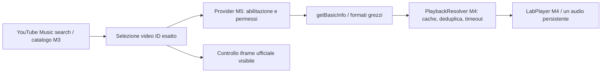

# M5 · YouTube Music playback feasibility

Verifica locale: 10 ottobre 2026, Windows, Node 24.14.0, pnpm 11.25.0,
`youtubei.js@18.1.0`. Branch `codex/m5-youtube-playback`; nessun push/PR o
collegamento a GitHub. Le modifiche M4 già presenti nella working tree sono
state preservate. Questo report riguarda il laboratorio M5; il player principale
e il provider di catalogo M3 non sono stati modificati.

## Valutazione

**MusicBit non è validato come player YouTube Music personale con audio nativo,
schermo bloccato e cambio automatico.** Il criterio completo con uno stream
YouTube.js autorizzato non è stato raggiunto. Mancano permessi documentati per
l'accesso diretto al servizio: zero richieste reali `/player` dal provider M5,
zero URL media estratti e zero riproduzioni native YouTube. Non è una prova
dell'impossibilità tecnica di ogni stream: quelle parti restano non verificate.

È stata invece dimostrata una riproduzione **foreground nel player ufficiale
visibile**, selezionando lo stesso video ID restituito dal catalogo YouTube Music.
Questo controllo non sostituisce il requisito del motore nativo, non usa
`PlaybackSource` e non viene conteggiato come successo del provider. Si mette
esplicitamente in pausa quando la pagina è nascosta.

Non raccomando di collegare il provider sperimentale al player principale.
Un percorso approvato dalla piattaforma per accesso diretto, audio separato e
background è un prerequisito, seguito da misure reali e prove iPhone. Il player
ufficiale può servire da controllo foreground, ma non soddisfa l'obiettivo
iniziale di MusicBit. Il catalogo rimane YouTube Music, senza sostituzioni.

## Capacità della versione installata

Analisi dei file locali in `apps/api/node_modules/youtubei.js/dist/src/`:

| Metodo / oggetto                          | Comportamento osservato nel codice 18.1.0                                         | Decisione M5                                               |
| ----------------------------------------- | --------------------------------------------------------------------------------- | ---------------------------------------------------------- |
| `Innertube.getBasicInfo(id)`              | Una richiesta `/youtubei/v1/player`; costruisce `VideoInfo`                       | Unico metodo media ammesso nel lab, dopo verifica permessi |
| `Innertube.getInfo(id)`                   | Richieste `/player` e `/next`, informazioni più estese                            | Non usato                                                  |
| `Innertube.getStreamingData(id, options)` | `getBasicInfo` → `chooseFormat` → `format.decipher(session.player)`               | Non usato: la decifratura è implicita                      |
| `VideoInfo` / `MediaInfo`                 | Metadati, playability, `streaming_data`, scelta formati; metodi download/DASH     | Si leggono solo playability e formati grezzi               |
| `Format`                                  | itag, MIME/codec, bitrate, durata, sample rate, URL o cipher, eventuali campi DRM | Diagnostica senza URL firmati                              |
| `download`, `toDash`, player JS           | Trasporto/trasformazioni ulteriori                                                | Non invocati                                               |

Riferimenti locali principali: `Innertube.js`, `core/mixins/MediaInfo.js`,
`parser/youtube/VideoInfo.js`, `parser/classes/misc/Format.js`,
`utils/FormatUtils.js`, `utils/HTTPClient.js`. La documentazione dei metodi è
disponibile nel [riferimento Innertube](https://ytjs.dev/api/classes/Innertube).
La libreria utilizza InnerTube, API privata con stabilità e blocchi IP non
garantiti; vedi [FAQ del progetto](https://ytjs.dev/guide/faq).

`retrieve_player:false` evita il caricamento del player JavaScript. Il gateway
crea una sessione anonima locale, senza login, cookie, configurazione remota,
token di integrità o challenge. Il trasporto ammette soltanto un POST HTTPS
`www.youtube.com/youtubei/v1/player` per il video ID autorizzato nello scope.
Rifiuta credenziali, altri endpoint, redirect e token; non conferma avvisi di
età/contenuto. Non cambia client dopo un errore e non effettua retry automatici.

Il test deterministico usa **la libreria installata reale**, con una risposta
HTTP sintetica: dimostra il percorso di parsing e l'assenza di altre richieste,
non la disponibilità dei formati sul servizio reale.

## Architettura e limitazioni dei formati

Il provider è indipendente dal catalogo. Il backend e la UI sono in
`apps/api/src/youtube-playback` e `experiments/youtube-playback`; il processo
principale non registra queste API. Il runtime Docker principale non serve
il laboratorio. Non ci sono proxy media, conversioni, cache audio o SW nel lab.

La risoluzione sceglie soltanto audio MP4/AAC (`mp4a.40.2` o `mp4a.40.5`),
senza video, cipher o campi DRM, con URL HTTPS grezzo su un sottodominio
`googlevideo.com` e percorso `/videoplayback`. WebM/Opus e altri formati vengono
mostrati in diagnostica ma non offerti al player nativo M5. Nessuna riscrittura
di signature o parametro `n`. MIME compatibile non equivale a riproducibilità.

La scadenza è il minimo tra `streaming_data.expires`, `expire` nell'URL e scadenza
del permesso; almeno una scadenza della sorgente deve essere nota. Cache solo dei
descrittori, TTL configurabile, mai oltre validità meno cinque secondi; si ricontrolla
prima di play. URL e validità dipendono dal servizio: possono cessare prima della
data dichiarata o essere legati al contesto/IP della richiesta. Un URL risolto
sul server Debian potrebbe non funzionare sull'iPhone. Non è stato verificato
e non viene introdotto un proxy per aggirare questa eventualità.

403 e 429 di `/player` sono normalizzati, con `Retry-After` numerico limitato,
senza salvare corpo, headers o errori grezzi. Il browser può restituire soltanto
`MEDIA_n` per un errore media cross-origin: non viene inventato lo status HTTP.
Il benchmark autorizzato può osservare status/tempi media tramite CDP Chromium,
senza esportare URL o headers; non è una capacità disponibile di Safari iOS.

## Permessi e conformità

La licenza pubblica del contenuto non autorizza automaticamente modalità di
accesso alla piattaforma. I [termini YouTube](https://www.youtube.com/static?template=terms)
limitano accesso automatizzato e uso del servizio fuori dai casi consentiti.
Le [Developer Policies](https://developers.google.com/youtube/terms/developer-policies)
richiedono permesso per API non documentate (III.D.7), restringono download/cache
(III.E.1), separazione audio/video e background del player nascosto (III.I.7–9).
Le API ufficiali non concedono da sole un'autorizzazione a InnerTube o agli URL
audio grezzi. L'uso personale non dimostra un'eccezione applicabile.

Contenuto di controllo: **Carefree — Kevin MacLeod (incompetech.com)**,
[CC BY 4.0, fonte dell'autore](https://incompetech.com/music/royalty-free/index.html?gt=&isrc=USUAN1400037),
senza modifiche. Video ID del risultato reale: `qapK8Gx6ZTo`.
La licenza del brano è documentata, ma non è stato fornito un permesso YouTube
per accedere a quel video come stream audio diretto; il video non è stato
aggiunto alla lista dei permessi. Il controllo usa esclusivamente l'iframe ufficiale.

La lista locale richiede per ogni ID riferimenti distinti al permesso del
contenuto e a quello di accesso al servizio. La validazione verifica la struttura,
**non l'autenticità o sufficienza giuridica** dei documenti. Non inserire i termini
generali, una licenza della libreria o un generico “no copyright” come prova di
permesso diretto. Il default senza record non contatta `/player`.

## Misure realmente effettuate

[Dati finali](performance/m5-live.json), cinque campioni sequenziali,
Chromium desktop, cache/sessione applicativa nuova per campione cold;
warm = ripetizione immediata nella stessa istanza. Cache OS/DNS/TLS/server non
controllate. Percentili nearest-rank, campione piccolo, HTTP loopback; esclusi
rete iPhone, input dell'utente, rendering copertine e primo suono fisico.

| Prova                                                  |                    n |          p50 |                                 p95 / esito |
| ------------------------------------------------------ | -------------------: | -----------: | ------------------------------------------: |
| Ricerca catalogo reale cold                            |                    5 |     508,2 ms |                                    593,5 ms |
| Ricerca catalogo reale warm                            |                    5 |      1,61 ms |                                     2,11 ms |
| Risoluzione diretta                                    | 0 richieste upstream | non misurata | 5 blocchi `DISABLED`, senza errori upstream |
| Preparazione / click → playing / cambio nativo YouTube |                    0 | non misurati |                            `null`, non zero |
| Iframe ufficiale: SDK → ready                          |                    1 |     653,6 ms |                          desktop foreground |
| Iframe ufficiale: click → stato `1`                    |                    1 |    1303,5 ms |      evento playing, nessuna prova al suono |

La prima prova del controllo iframe aveva costruito il player senza video ID
iniziale e riportato errore `2`. Il problema è stato corretto passando il video ID
alla costruzione, quindi la prova è stata ripetuta con successo. Evidenza precedente
conservata in [m5-initial-live.json](performance/m5-initial-live.json); non è
considerata una restrizione YouTube né un confronto prestazionale controllato.
Non sono state introdotte ottimizzazioni del player principale sulla base di
queste misure. Non esiste una misura cold/warm degli stream reali da confrontare.

## Dimostrato, bloccato, da verificare

| Capacità                                                                          | Evidenza / stato                                                                               |
| --------------------------------------------------------------------------------- | ---------------------------------------------------------------------------------------------- |
| Ricerca reale YouTube Music, stesso ID selezionato                                | Benchmark live riuscito                                                                        |
| Riproduzione ufficiale visibile foreground                                        | Stato iframe `1` su Carefree; distinto dal motore nativo                                       |
| Native lab: selezione → risoluzione → prep → play → next                          | E2E con PCM originale e provider iniettato solo dal server di test; **non uno stream YouTube** |
| Provider AAC, expiry, errori 403/429, nessun retry, cache/deduplica/cancellazione | Mock deterministici; servizio media non sondato                                                |
| Stream diretto YouTube autorizzato                                                | Bloccato: permessi di accesso diretto non documentati                                          |
| Formati/codec/URL validi sul servizio reale                                       | Non osservati con il provider M5                                                               |
| 403/429 da stream YouTube reale, source IP binding                                | Non osservati; nessuna conclusione inventata                                                   |
| Compatibilità AAC su Safari iOS fisico                                            | Non testata; `canPlayType` è solo un'indicazione                                               |
| Schermo bloccato, next automatico nativo M5, CarPlay                              | Non testati su dispositivo                                                                     |

Il controller nativo conserva un audio persistente, richiama play sincronicamente
dal gesto dopo la risoluzione e consente preparazione esplicita mentre è in pausa.
La prossima traccia viene risolta senza precaricare un secondo audio. Un click
di ricerca che attende il backend non mantiene necessariamente il gesto iOS:
il laboratorio richiede un successivo Play esplicito. Non si assume che preload,
Media Session o eventi JS continuino a funzionare in background. La checklist
fisica è in [youtube-playback-ios-checklist.md](youtube-playback-ios-checklist.md).

Le conferme iPhone M2 restano valide per il player/demo allora provato, non per
YouTube o il lab M5. Nessuna prova fisica M5/CarPlay dichiarata superata.

## Ripetere le prove

Controlli locali superati: installazione con lockfile congelato, `pnpm check`
(lint, typecheck, **141 Vitest**, build), **40 E2E** Chromium/WebKit emulati,
smoke HTTPS CA/SAN, Prettier e whitespace Git. Test M1–M4 mantenuti: aggiunti
33 unit test e 10 esecuzioni E2E. [Registro completo](validation.md).

`pnpm check`, `pnpm test:e2e` sono deterministici. `pnpm benchmark:youtube`
effettua richieste reali del solo catalogo con default M5 disabilitato. PowerShell
`$env:YOUTUBE_OFFICIAL_CONTROL='true'` abilita nel benchmark il controllo iframe
solo sul risultato Carefree/Kevin MacLeod con licenza documentata. Non richiede
né introduce credenziali. In caso di blocco non cambiare client/IP per eluderlo.

`YOUTUBE_PLAYBACK_BENCHMARK_RUNS` accetta 1–10, default 5. Query opzionale
`YOUTUBE_PLAYBACK_BENCHMARK_QUERY`. Report `docs/performance/m5-live.json` viene
sovrascritto a ogni esecuzione: copiare le evidenze precedenti prima di ripetere.
Il codice 0 del benchmark indica esecuzione senza errori del catalogo/harness,
**non** successo del criterio native: controllare `summary.resolved`, `blocked`,
`playback` e `official` nel JSON. Valori mancanti restano null.

Con permessi reali e flag abilitato, il benchmark cerca un ID autorizzato nei
risultati: misura risoluzione cold/warm, playback diretto/preparato e cambio
se un secondo ID autorizzato compare nei risultati. Nessun fallback a demo;
in caso di errore media non tenta una modalità/client alternativa.
